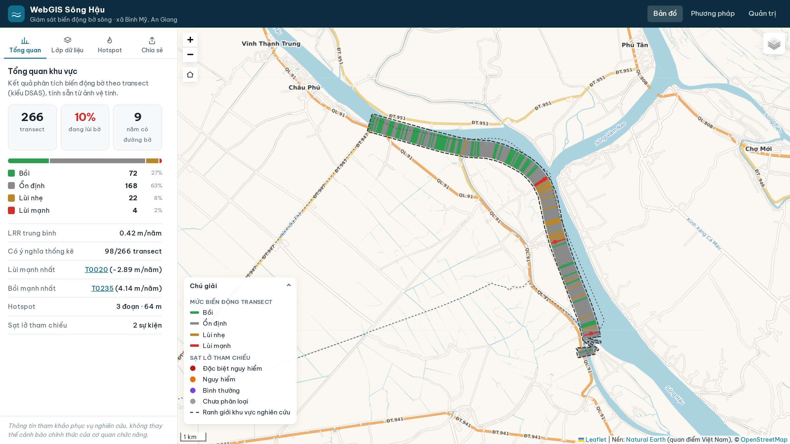
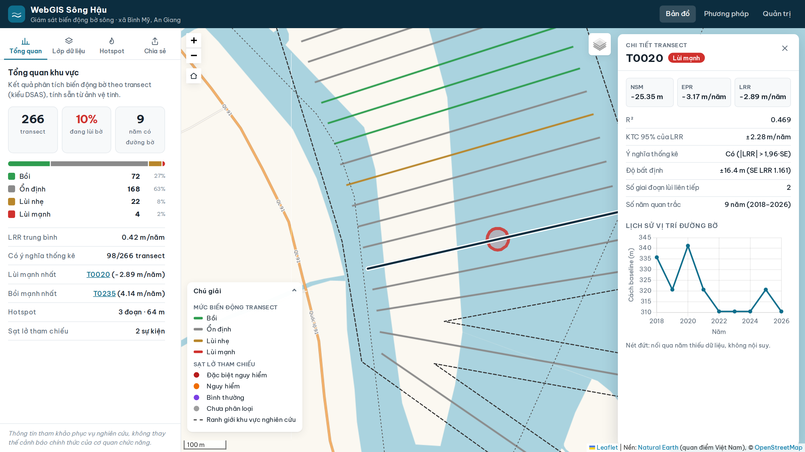
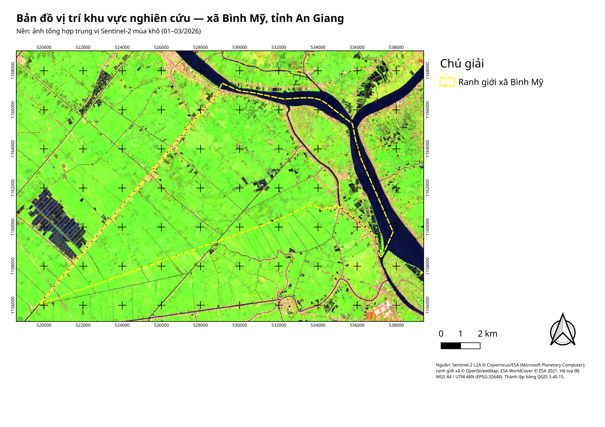
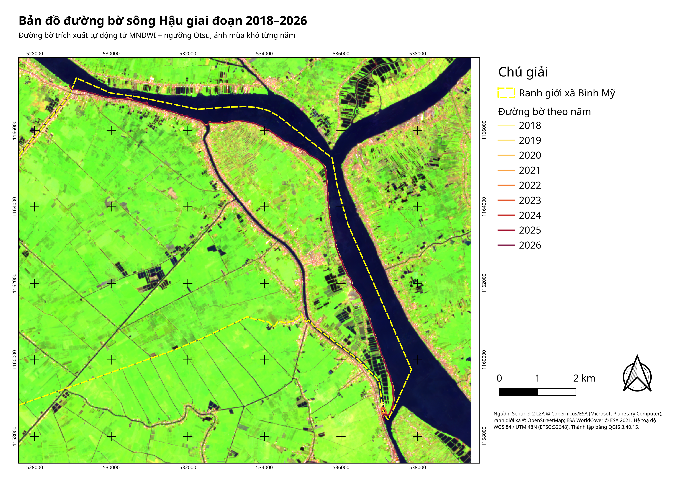
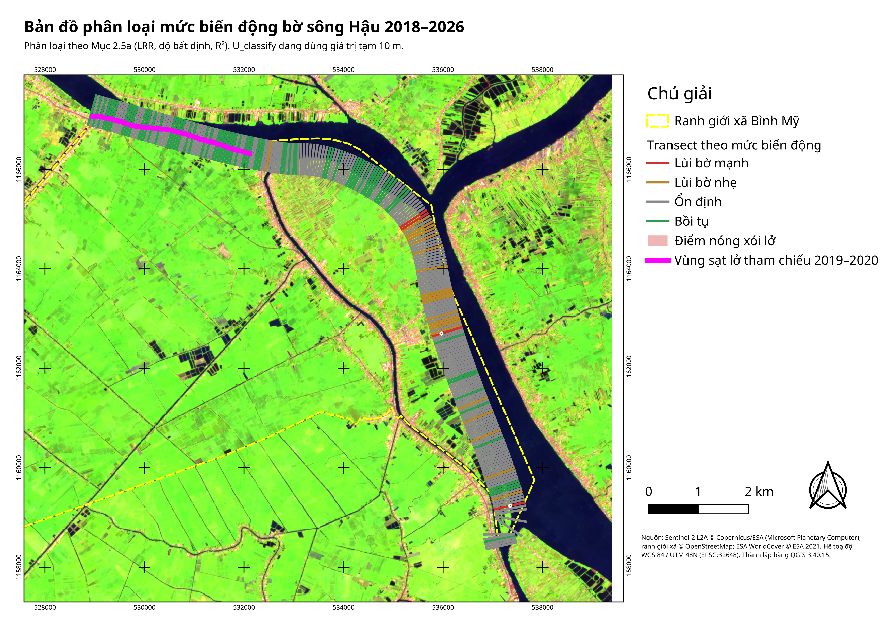
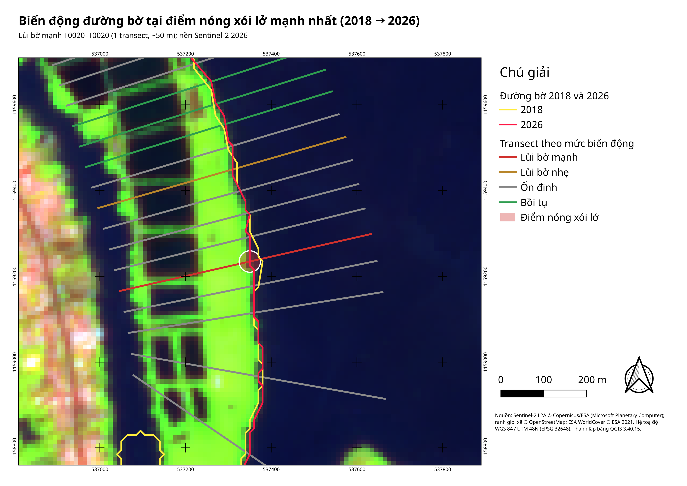
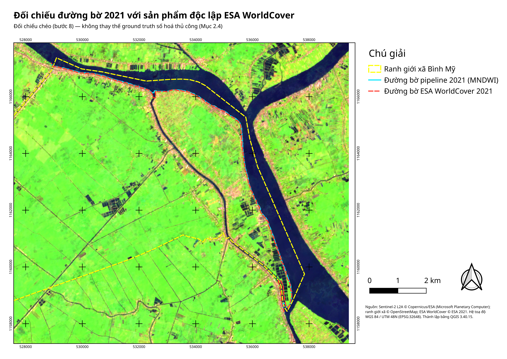
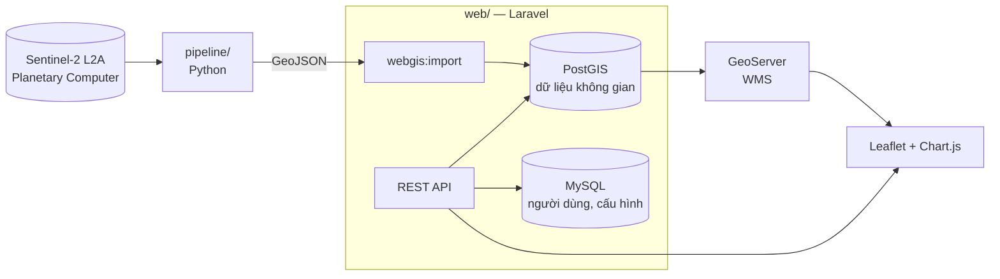

# WebGIS giám sát biến động bờ sông Hậu

[](https://github.com/nvs15122k4/web-gis/actions/workflows/ci.yml)


Hệ thống WebGIS theo dõi biến động đường bờ sông Hậu tại xã Bình Mỹ (An Giang) giai đoạn 2018–2026 từ ảnh vệ tinh
Sentinel-2: trích xuất đường bờ từng năm, tính tốc độ biến động trên transect (NSM, EPR, LRR, R²), phát hiện điểm
nóng xói lở và hiển thị trên bản đồ web tương tác.

## Tính năng

- **Bản đồ tương tác** — đường bờ theo năm, transect tô màu theo mức biến động, điểm nóng xói lở, sự kiện sạt lở tham chiếu (Leaflet + WMS GeoServer).
- **Phân tích transect** — biểu đồ chuỗi khoảng cách theo năm, chỉ số NSM/EPR/LRR/R² và độ bất định.
- **Tổng quan** — thống kê theo mức biến động, lọc điểm nóng theo ngưỡng, liên kết chia sẻ (permalink).
- **Xuất dữ liệu** — tải các lớp dưới dạng GeoJSON/CSV qua REST API.
- **Quản trị** — đăng nhập (Sanctum) để chỉnh ngưỡng hiển thị; mọi thay đổi được ghi nhật ký.

## Hình ảnh

Toàn bộ hình chỉ thể hiện khu vực đề tài — đoạn bờ sông Hậu thuộc xã Bình Mỹ, An Giang.

| | |
|---|---|
|  |  |
| Bản đồ tổng quan: 266 transect theo mức biến động | Chi tiết transect T0020: NSM/EPR/LRR/R², lịch sử vị trí đường bờ |

**Bản đồ chuyên đề** — thành lập bằng QGIS 3.40 (print layout, script PyQGIS [`pipeline/qgis_maps.py`](pipeline/qgis_maps.py)),
nền ảnh tổng hợp Sentinel-2, hệ toạ độ WGS 84 / UTM 48N, xuất 300 dpi:

| | | |
|---|---|---|
| [](docs/ban_do/vi_tri.png) | [](docs/ban_do/duong_bo.png) | [](docs/ban_do/phan_loai.png) |
| Vị trí khu vực nghiên cứu | Đường bờ 2018–2026 | Phân loại mức biến động |
| [](docs/ban_do/duong_bo_chi_tiet.png) | [](docs/ban_do/doi_chieu_2021.png) | |
| Điểm nóng xói lở mạnh nhất | Đối chiếu với ESA WorldCover 2021 | |

**Sơ đồ** (Mermaid): [kiến trúc](docs/assets/architecture.png) · [ERD PostGIS](docs/assets/er-postgis.png) ·
[ERD MySQL](docs/assets/er-mysql.png) · [tiến độ](docs/assets/gantt.png). Trang giới thiệu & phương pháp:
[ảnh](docs/minh_chung/03_trang_gioi_thieu.png).

## Kiến trúc



Web chỉ **đọc** kết quả: mọi chỉ số được pipeline tính sẵn, Laravel không tính lại.

## Cấu trúc thư mục

```
.
├── pipeline/   Xử lý ảnh Sentinel-2 → đường bờ, transect, thống kê (Python)
├── web/        Ứng dụng WebGIS: API, giao diện bản đồ, cấu hình GeoServer (Laravel)
├── e2e/        Kiểm thử đầu-cuối (Playwright)
└── .github/    CI và mẫu issue / pull request
```

| Thành phần | Công nghệ | Tài liệu |
|---|---|---|
| Pipeline | Python, rasterio, xarray, geopandas, scikit-image | [`pipeline/README.md`](pipeline/README.md) |
| Web | Laravel 13, PostGIS, MySQL, GeoServer, Leaflet, Chart.js, Tailwind CSS | [`web/README.md`](web/README.md) |
| E2E | Playwright (Chromium, Firefox, WebKit) | [`web/README.md#5-kiểm-thử`](web/README.md#5-kiểm-thử) |

## Bắt đầu nhanh

Yêu cầu: PHP ≥ 8.4, Composer, Node ≥ 20, Docker (hoặc MySQL 8 + PostgreSQL/PostGIS + GeoServer cài sẵn).

```bash
git clone git@github.com:nvs15122k4/web-gis.git && cd web-gis/web

docker compose up -d                       # MySQL :3307, PostGIS :5432, GeoServer :8080
composer install && npm install
cp .env.example .env && php artisan key:generate   # chỉnh DB_* và DB_PGSQL_*

php artisan migrate --seed
php artisan webgis:import ../pipeline/output       # nạp kết quả pipeline có sẵn trong repo
python3 geoserver/basemap/build_basemap.py         # nền bản đồ tự phục vụ (Natural Earth quan điểm VN + OSM)
geoserver/provision.sh songhau webgis_spatial      # workspace, store, style, layer, nền nen_ban_do

npm run build && php artisan serve                 # http://127.0.0.1:8000
```

Chạy lại pipeline từ ảnh gốc: xem [`pipeline/README.md`](pipeline/README.md).

## Kiểm thử

```bash
cd web && php artisan migrate --env=testing && php artisan test   # PHPUnit
cd e2e && npm ci && npx playwright test                           # Playwright E2E
```

CI trên GitHub Actions chạy PHPUnit (MySQL + PostGIS), build front-end và kiểm tra cú pháp pipeline cho mỗi push và pull request.

## Dữ liệu

Dữ liệu trong `pipeline/output/` và `pipeline/data/` là **bản demo** phục vụ phát triển; độ bất định phân loại đang dùng
giá trị tạm cho đến khi hoàn tất đánh giá độ chính xác với ground truth.
Ảnh Sentinel-2: © Copernicus / ESA, truy cập qua Microsoft Planetary Computer.

## Tác giả

Nguyễn Văn Sang — đồ án tốt nghiệp.
