# WebGIS giám sát biến động bờ sông Hậu

[](https://github.com/nvs15122k4/web-gis/actions/workflows/ci.yml)


Hệ thống WebGIS theo dõi biến động đường bờ sông Hậu tại xã Bình Mỹ (An Giang) giai đoạn 2018–2026 từ ảnh vệ tinh
Sentinel-2: trích xuất đường bờ từng năm, tính tốc độ biến động trên transect (NSM, EPR, LRR, R²), phát hiện điểm
nóng xói lở và hiển thị trên bản đồ web tương tác.

## Tính năng

Ứng dụng web (Laravel + Leaflet + Chart.js) gồm các trang sau; ảnh chụp từ bản chạy thật trên dữ liệu pipeline (267 transect).

| Đường dẫn | Quyền | Nội dung |
|---|---|---|
| `/` | công khai | Bản đồ tương tác với 4 thẻ: Tổng quan, Lớp dữ liệu, Hotspot, Chia sẻ |
| `/gioi-thieu` | công khai | Phương pháp (DSAS: NSM, EPR, LRR, R²), tiêu chí phân loại, độ bất định, hạn chế, liên kết WMS/WFS |
| `/huong-dan` | công khai | Hướng dẫn sử dụng, đọc kết quả, hỏi đáp, hỗ trợ bàn phím |
| `/dang-nhap` | công khai | Đăng nhập bằng phiên (khoá tạm sau 5 lần sai) |
| `/admin` | `admin` | Sửa ngưỡng hiển thị hotspot `min_erosion_rate`; mọi thay đổi ghi `activity_logs` |
| `/bao-cao` | `admin` | Báo cáo nội bộ: tiến độ theo đề cương, mốc thời gian, kiểm thử |
| `/api/*` | công khai (trừ ghi) | REST trả GeoJSON/JSON EPSG:4326; xem bảng bên dưới |

### Bản đồ

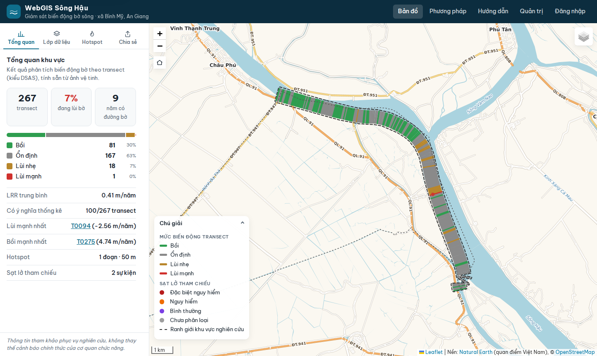

*Thẻ **Tổng quan**: 267 transect tô màu theo mức biến động (bồi / ổn định / lùi nhẹ / lùi mạnh), thống kê, hotspot, sạt lở tham chiếu,
ranh giới khu vực nghiên cứu. Nền bản đồ tự phục vụ trên GeoServer.*

| | |
|---|---|
| 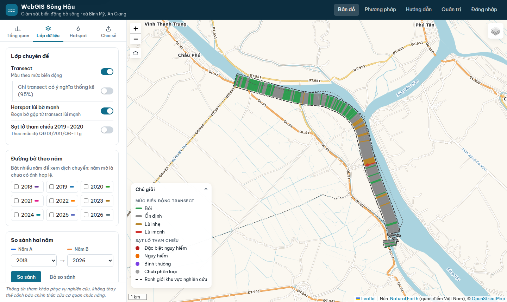 | 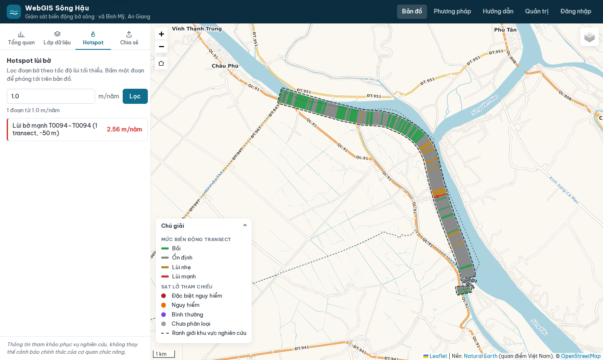 |
| **Lớp dữ liệu**: bật/tắt transect, hotspot, sạt lở tham chiếu; đường bờ từng năm 2018–2026; so sánh hai năm | **Hotspot**: lọc đoạn lùi bờ theo tốc độ tối thiểu (m/năm), bấm một đoạn để phóng tới |
| 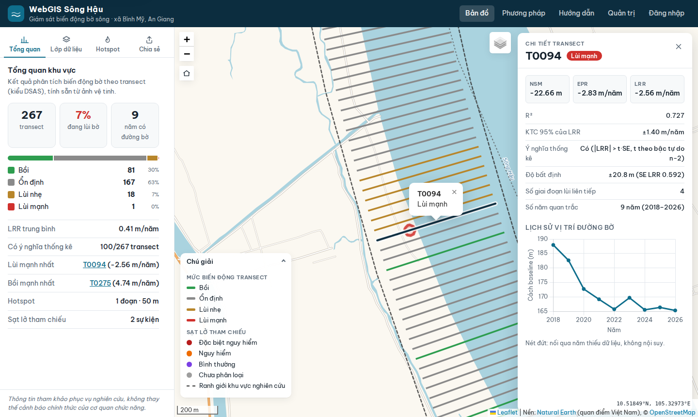 | 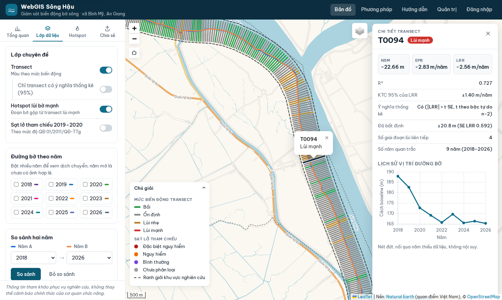 |
| **Chi tiết transect T0094**: NSM, EPR, LRR, R², khoảng tin cậy 95%, độ bất định, biểu đồ lịch sử vị trí đường bờ | **So sánh hai năm**: chồng hai đường bờ để xem dịch chuyển |

- **Chia sẻ & xuất dữ liệu** — liên kết chia sẻ lưu khung nhìn, lớp, năm trong URL (`#map=…`); tải từng lớp dạng GeoJSON/CSV tại `/api/export/{lớp}.{geojson|csv}`.
- **Giao diện di động** — bố cục thu gọn, xem [ảnh](docs/minh_chung/giao_dien/13_di_dong.png).

### Các trang còn lại

| | |
|---|---|
| 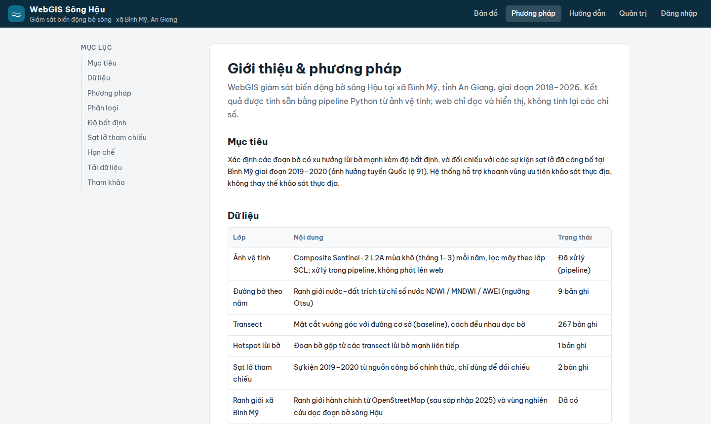 | 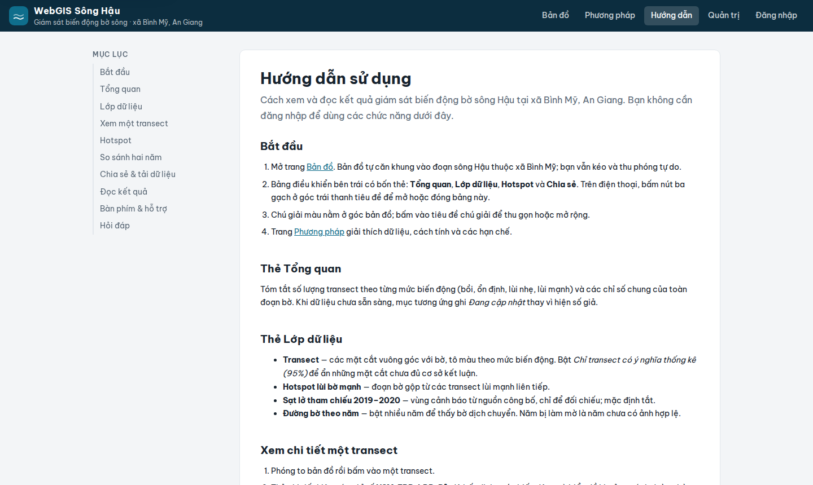 |
| `/gioi-thieu` — phương pháp và hạn chế | `/huong-dan` — hướng dẫn sử dụng |
| 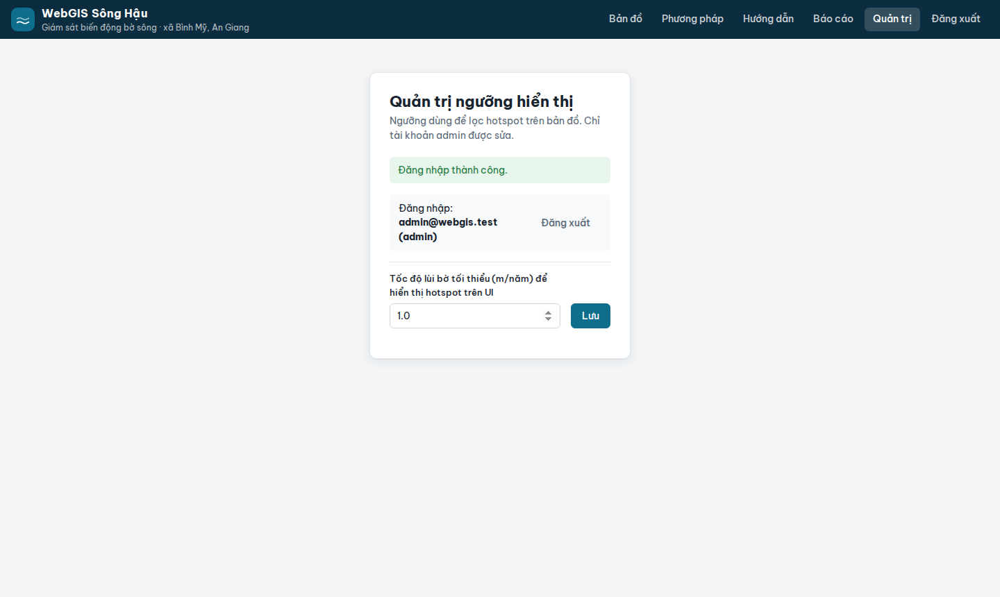 | 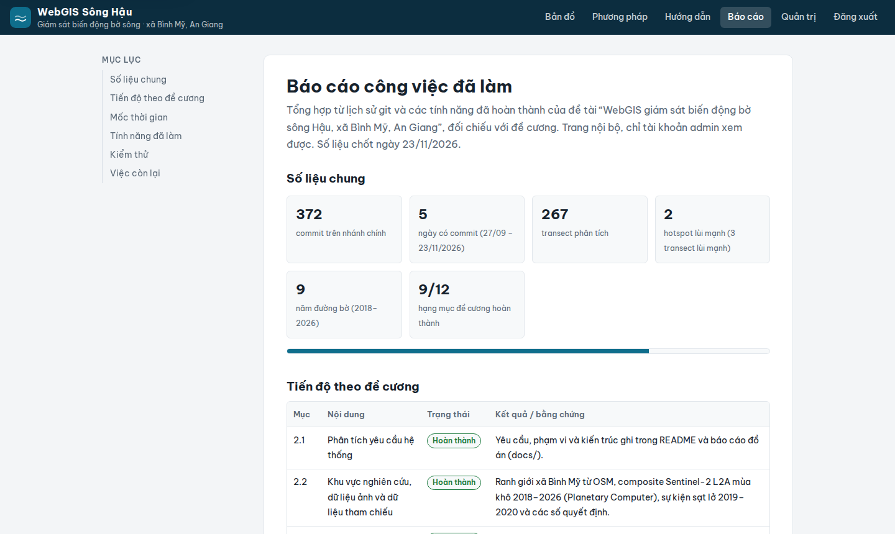 |
| `/admin` — chỉnh ngưỡng hiển thị (cần quyền `admin`) | `/bao-cao` — báo cáo nội bộ (cần quyền `admin`) |

### REST API

| Phương thức | Đường dẫn | Mô tả |
|---|---|---|
| GET | `/api/status` | Tình trạng MySQL, PostGIS, GeoServer và số bản ghi |
| GET | `/api/summary` | Thống kê theo mức biến động, transect lùi/bồi mạnh nhất, hotspot, sạt lở tham chiếu |
| GET | `/api/shorelines` | Đường bờ theo năm |
| GET | `/api/transects`, `/api/transects/{id}`, `/api/transects/{id}/history` | Transect, chi tiết, chuỗi khoảng cách theo năm |
| GET | `/api/erosion-hotspots` | Đoạn lùi bờ mạnh |
| GET | `/api/reference-events` | Sạt lở tham chiếu 2019–2020 |
| GET | `/api/config/thresholds` | Ngưỡng hiển thị hiện hành |
| GET | `/api/export/{lớp}.{geojson\|csv}` | Tải dữ liệu |
| POST | `/api/auth/login` | Cấp token Sanctum |
| PUT | `/api/admin/config/thresholds/{key}` | Sửa ngưỡng (`admin`) |

## Bản đồ chuyên đề và sơ đồ

Bản đồ chuyên đề thành lập bằng QGIS 3.40 (print layout, script PyQGIS [`pipeline/qgis_maps.py`](pipeline/qgis_maps.py)),
nền ảnh tổng hợp Sentinel-2, hệ toạ độ WGS 84 / UTM 48N, xuất 300 dpi. Toàn bộ hình chỉ thể hiện khu vực đề tài —
đoạn bờ sông Hậu thuộc xã Bình Mỹ, An Giang.

| | | |
|---|---|---|
| [](docs/ban_do/vi_tri.png) | [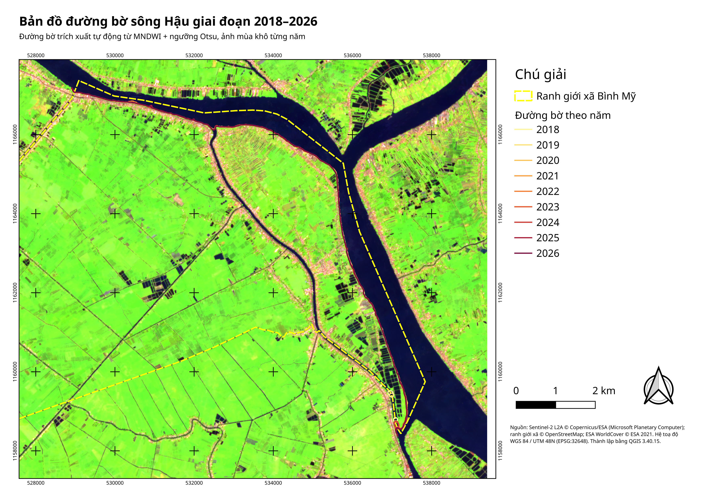](docs/ban_do/duong_bo.png) | [](docs/ban_do/phan_loai.png) |
| Vị trí khu vực nghiên cứu | Đường bờ 2018–2026 | Phân loại mức biến động |
| [](docs/ban_do/duong_bo_chi_tiet.png) | [](docs/ban_do/doi_chieu_2021.png) | |
| Điểm nóng xói lở mạnh nhất | Đối chiếu với ESA WorldCover 2021 | |

**Sơ đồ** (Mermaid): [kiến trúc](docs/assets/architecture.png) · [ERD PostGIS](docs/assets/er-postgis.png) ·
[ERD MySQL](docs/assets/er-mysql.png) · [tiến độ](docs/assets/gantt.png).

## Kiến trúc

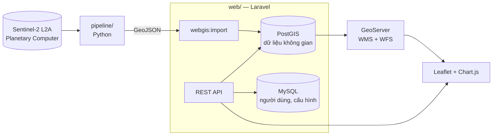

Web chỉ **đọc** kết quả: mọi chỉ số được pipeline tính sẵn, Laravel không tính lại.

## Cấu trúc thư mục

```
.
├── pipeline/   Xử lý ảnh Sentinel-2 → đường bờ, transect, thống kê (Python)
├── web/        Ứng dụng WebGIS: API, giao diện bản đồ, cấu hình GeoServer (Laravel)
├── e2e/        Kiểm thử đầu-cuối (Playwright)
└── .github/    CI và mẫu issue / pull request
```

| Thành phần | Công nghệ | Tài liệu |
|---|---|---|
| Pipeline | Python, rasterio, xarray, geopandas, scikit-image | [`pipeline/README.md`](pipeline/README.md) |
| Web | Laravel 13, PostGIS, MySQL, GeoServer, Leaflet, Chart.js, Tailwind CSS | [`web/README.md`](web/README.md) |
| E2E | Playwright (Chromium, Firefox, WebKit) | [`web/README.md#5-kiểm-thử`](web/README.md#5-kiểm-thử) |

## Bắt đầu nhanh

Yêu cầu: PHP ≥ 8.4, Composer, Node ≥ 20, Docker (hoặc MySQL 8 + PostgreSQL/PostGIS + GeoServer cài sẵn).

```bash
git clone git@github.com:nvs15122k4/web-gis.git && cd web-gis/web

docker compose up -d                       # MySQL :3307, PostGIS :5432, GeoServer :8080
composer install && npm install
cp .env.example .env && php artisan key:generate   # chỉnh DB_* và DB_PGSQL_*

php artisan migrate --seed
php artisan webgis:import ../pipeline/output       # nạp kết quả pipeline có sẵn trong repo
python3 geoserver/basemap/build_basemap.py         # nền bản đồ tự phục vụ (Natural Earth quan điểm VN + OSM)
geoserver/provision.sh songhau webgis_spatial      # workspace, store, style, layer, nền nen_ban_do

npm run build && php artisan serve                 # http://127.0.0.1:8000
```

> Docker compose chiếm cổng 5432 và 8080; nếu máy đã chạy sẵn PostgreSQL/GeoServer, hãy dừng chúng hoặc đổi cổng trong `docker-compose.yml` và `.env`.

Chạy lại pipeline từ ảnh gốc: xem [`pipeline/README.md`](pipeline/README.md).

## Kiểm thử

```bash
cd web && php artisan migrate --env=testing && php artisan test   # PHPUnit
cd e2e && npm ci && npx playwright test                           # Playwright E2E
```

PHPUnit dùng CSDL riêng `webgis_app_test` và `webgis_spatial_test` (tạo trước, cùng tài khoản với `.env`); `phpunit.xml` đã đặt sẵn `APP_ENV=testing`, `APP_DEBUG=false`, không cần `.env.testing`.

CI trên GitHub Actions chạy PHPUnit (MySQL + PostGIS), build front-end và kiểm tra cú pháp pipeline cho mỗi push và pull request.

## Tài khoản kiểm thử

Tạo bởi seeder trong `web/database/seeders/` (mật khẩu chỉ dùng cho môi trường phát triển, đổi khi triển khai thật):

| Email | Mật khẩu | Vai trò | Nguồn | Ghi chú |
|---|---|---|---|---|
| `admin@webgis.test` | `password` | `admin` | `php artisan db:seed` (`DatabaseSeeder`) | Vào trang quản trị `/admin` để sửa ngưỡng hiển thị |
| `viewer@webgis.test` | `password` | `viewer` | `E2eFixtureSeeder` | Chỉ có trong CSDL kiểm thử/E2E, dùng cho kịch bản từ chối quyền |

`ThresholdConfigSeeder` nạp ngưỡng mặc định `min_erosion_rate = 1.0` (m/năm). `E2eFixtureSeeder` dựng dữ liệu tổng hợp cố định (10 transect T01–T10, 2018–2026, thiếu năm 2022) cho Playwright/PHPUnit, không dùng chung CSDL phát triển.
Đăng nhập sai 5 lần theo email hoặc IP sẽ bị khoá tạm (HTTP 429); token Sanctum hết hạn sau 480 phút (`SANCTUM_TOKEN_EXPIRATION`).

## Cấu trúc cơ sở dữ liệu

Hai CSDL, theo các migration trong `web/database/migrations/`.

**MySQL** (người dùng và cấu hình):

| Bảng | Cột chính |
|---|---|
| `users` | `id`, `name`, `email` (unique), `password`, `role` (`admin` \| `viewer`, mặc định `viewer`) |
| `threshold_configs` | `key` (unique), `value`, `description`, `updated_by` → `users` |
| `activity_logs` | `user_id` → `users`, `action`, `ip_address`, `created_at` |
| `personal_access_tokens` | token Sanctum |
| `sessions`, `password_reset_tokens`, `cache`, `jobs` | bảng hệ thống của Laravel |

**PostgreSQL/PostGIS** (không gian, hình học EPSG:4326, chỉ mục GiST trên `geom`; thư mục `migrations/pgsql/`):

| Bảng / view | Nội dung |
|---|---|
| `baseline` | đường cơ sở, `LineString` |
| `shorelines` | đường bờ theo năm, `MultiLineString`; `year`, `water_index`, `source_image_date`; unique `(year, water_index)` |
| `transects` | `transect_code` (unique), `baseline_id` → `baseline`, `geom` |
| `transect_shoreline_distances` | khoảng cách baseline → bờ `distance_m` theo `(transect_id, year)` |
| `shoreline_change_stats` | mỗi transect một dòng: `nsm_m`, `epr_m_per_year`, `lrr_m_per_year`, `se_lrr`, `unc_lrr` (nửa bề rộng KTC 95% của LRR, Student t df = n − 2), `r_squared`, `is_significant`, `change_class` (`accretion` \| `stable` \| `mild_erosion` \| `severe_erosion`), `consecutive_erosion_periods`, `u_shoreline_avg` |
| `erosion_hotspots` | đoạn lùi bờ mạnh: `severity` (m/năm), `period_start_year`, `period_end_year`, `notes` |
| `reference_landslide_events` | sạt lở tham chiếu: `event_date`, `description`, `source`, `danger_level` (`dac_biet_nguy_hiem` \| `nguy_hiem` \| `binh_thuong`), `length_m`, `location` |
| `transects_styled` (view) | `transects` ghép `shoreline_change_stats`, dùng cho GeoServer (lọc `is_significant` bằng CQL_FILTER) |

## Kết quả thực nghiệm

Trích từ `pipeline/output/*.json` (bản demo, sinh bởi pipeline).

**Tổng quan** (`summary.json`): 267 transect, chỉ số nước đang dùng `mndwi`, 13 quan sát bị khử đột biến, 1 hotspot.

| Lớp biến động | Số transect |
|---|---|
| Bồi (`accretion`) | 81 |
| Ổn định (`stable`) | 167 |
| Lùi nhẹ (`mild_erosion`) | 18 |
| Lùi mạnh (`severe_erosion`) | 1 |

Tiêu chí chốt trước khi chạy lại (không chỉnh theo kết quả): có ý nghĩa thống kê khi |LRR| > t(0,975; n − 2)·SE (n = 9 năm thì t = 2,365);
lùi mạnh khi có ý nghĩa, LRR ≤ −2 m/năm và khoảng cách giảm liên tục ≥ 3 mốc năm liền nhau; R² &lt; 0,3 chỉ là cờ chất lượng.
Trước đó dùng z = 1,96 và ngưỡng M − S = −1,804 m/năm (tính trên chính kết quả, hậu nghiệm): 124 transect có ý nghĩa, 3 lùi mạnh, 2 hotspot.
Hotspot (`hotspots.json`, giai đoạn 2018–2026): 1 đoạn gồm T0094 (1 transect, ~50 m, LRR −2,56 m/năm).
Độ bất định đường bờ `u_shoreline` (1σ, U_georef quy từ 12 m ở 95,5% về 6 m) theo năm: 17,00 m (2018), 19,98 m (2022), 21,47 m (các năm còn lại).

**Đánh giá so với ground truth số hoá** (`evaluation.json`, 5 ô mẫu mỗi năm, 18.000 pixel/chỉ số). Giá trị F1 / IoU:

| Năm | NDWI | MNDWI | AWEI |
|---|---|---|---|
| 2018 | 0,9483 / 0,9017 | 0,9465 / 0,8984 | 0,9430 / 0,8922 |
| 2022 | 0,9366 / 0,8807 | 0,9493 / 0,9035 | 0,9450 / 0,8957 |
| 2026 | 0,9345 / 0,8770 | 0,9411 / 0,8887 | 0,9491 / 0,9032 |
| F1 trung bình 3 năm | 0,9398 | 0,9456 | 0,9457 |

Chỉ số tốt nhất theo F1 trung bình: `awei` (`best_index_by_mean_f1`), hơn `mndwi` không đáng kể (0,9457 so với 0,9456). Sai số đường bờ so với ground truth:

| Năm | Số transect | Sai số TB (m) | Sai số tuyệt đối TB (m) | RMSE (m) |
|---|---|---|---|---|
| 2018 | 58 | 1,58 | 9,23 | 15,10 |
| 2022 | 58 | 0,80 | 11,38 | 18,39 |
| 2026 | 59 | 4,01 | 13,45 | 19,99 |

RMSE này là gợi ý `U_classify` (15,1 / 18,39 / 19,99 m).

**Đối chiếu chéo** (`crosscheck.json`) với sản phẩm phủ bề mặt độc lập WorldCover (2020–2021) và IO-LULC (2018–2023). Chỉ để kiểm tra độ hợp lý, không thay ground truth và không dùng điền `U_CLASSIFY`. F1 trung bình toàn bộ: NDWI 0,8582, MNDWI 0,8765, AWEI 0,8810 (tốt nhất: `awei`). Độ lệch đường bờ RMSE: 46,92–70,66 m, cao hơn nhiều so với ground truth số hoá vì sản phẩm đối chiếu chỉ chính xác ~75–85%.

| Nguồn | Năm | F1 MNDWI | F1 AWEI | RMSE đường bờ (m) |
|---|---|---|---|---|
| WorldCover | 2020 | 0,8918 | 0,9063 | 70,66 |
| WorldCover | 2021 | 0,9179 | 0,9201 | 60,53 |
| IO-LULC | 2018 | 0,8569 | 0,8249 | 46,92 |
| IO-LULC | 2019 | 0,7844 | 0,7926 | 49,67 |
| IO-LULC | 2020 | 0,8943 | 0,9038 | 59,92 |
| IO-LULC | 2021 | 0,8959 | 0,9093 | 52,29 |
| IO-LULC | 2022 | 0,8837 | 0,8917 | 51,92 |
| IO-LULC | 2023 | 0,8871 | 0,8993 | 51,07 |

## Đối chiếu với đề cương và yêu cầu

Đối chiếu bản web đang chạy (chụp ngày 23/11/2026, dữ liệu 267 transect) với đề cương đồ án (mục 2.1, 2.5, 3.5–3.7) và
`docs/tai-lieu/yeu-cau.txt`.

**Đã đáp ứng:** nền bản đồ; đường bờ 2018–2026 bật/tắt và so sánh hai năm; transect và hotspot tô màu theo mức biến động;
lớp sạt lở tham chiếu; chọn transect xem NSM/EPR/LRR/R², độ bất định và biểu đồ lịch sử (Chart.js); lọc hotspot theo ngưỡng;
API từ PostGIS; WMS/WFS qua GeoServer; MySQL lưu người dùng, ngưỡng, nhật ký; Playwright E2E.

**Chỗ lệch (web thực tế khác hoặc vượt đề cương):**

| # | Đề cương / yêu cầu | Thực tế | Ghi chú |
|---|---|---|---|
| 1 | Phân loại 3 mức: bồi, ổn định, lùi bờ mạnh (2.1) | 4 mức: thêm **lùi nhẹ** | Đúng với tiêu chí chốt ở mục 2.5; đề cương mục 2.1 chưa nhắc "lùi nhẹ" |
| 2 | "Không yêu cầu phân quyền phức tạp" (2.1) | Có đăng nhập, vai trò `admin`/`viewer`, token Sanctum, trang `/admin` | Chỉ để sửa ngưỡng; phần xem vẫn công khai |
| 3 | "Lọc đoạn bờ vượt ngưỡng cấu hình" (2.1) | Ngưỡng `min_erosion_rate` = 1,0 m/năm chỉ lọc **hotspot đã có**; ngưỡng phân loại của pipeline là LRR ≤ −2 m/năm | Hai ngưỡng khác nhau, người dùng dễ nhầm; đang chờ quyết định |
| 4 | Bật/tắt "ranh giới AOI" trong bảng lớp (2.5) | AOI luôn hiển thị (nét đứt), có trong chú giải nhưng **không có công tắc** | |
| 5 | WFS phục vụ chọn đối tượng và lọc (2.5) | Việc chọn transect và lọc đi qua REST API của Laravel; WFS được công bố và kiểm tra nhưng giao diện không gọi | |
| 6 | API dùng `ST_Distance`, `ST_Intersection` để tính sẵn (2.5) | Chỉ truy vấn tổng hợp hotspot dùng hàm không gian; chỉ số do pipeline tính sẵn, Laravel không tính lại | Phù hợp nguyên tắc "web chỉ đọc" |
| 7 | Sạt lở tham chiếu 2019–2020 làm dữ liệu kiểm chứng | 2 sự kiện, vị trí số hoá từ nguồn báo chí/UBND tỉnh, có vùng cảnh báo ~3,3 km; 0/2 sự kiện nằm trong 500 m của hotspot | Chưa có dữ liệu thật từ UBND xã hay Ban chỉ huy PCTT-TKCN An Giang (yêu cầu liên hệ); xem [`docs/checklist-yeu-cau.md`](docs/checklist-yeu-cau.md) |
| 8 | Chọn chỉ số nước theo F1 trung bình, hoà thì xét RMSE | F1 tốt nhất là `awei` (0,9457), nhưng chỉ số mặc định đang dùng `mndwi` (0,9456); chưa có bước xét RMSE trong mã | Chênh không đáng kể |
| 9 | (không có trong đề cương) | Có thêm `/gioi-thieu`, `/huong-dan`, `/bao-cao`, liên kết chia sẻ, xuất GeoJSON/CSV, nền tự phục vụ, giao diện di động | Bổ sung ngoài phạm vi |
| 10 | Số liệu nhất quán | Trang `/bao-cao` ghi cố định "2 hotspot lùi mạnh (3 transect lùi mạnh)" (`web/resources/views/report/index.blade.php`, dòng 53), trong khi dữ liệu hiện có 1 hotspot và 1 transect lùi mạnh (sau khi chốt tiêu chí t(df = n − 2), LRR ≤ −2) | Số liệu trên trang cũ, cần sửa |

Yêu cầu trong `yeu-cau.txt` (chốt trước tiêu chí lùi bờ mạnh, công thức độ bất định có nguồn, văn phong đề cương, bảng 15 tuần) thuộc
phần tài liệu; tình trạng từng mục xem [`docs/checklist-yeu-cau.md`](docs/checklist-yeu-cau.md).

## Dữ liệu

Dữ liệu trong `pipeline/output/` và `pipeline/data/` là **bản demo** phục vụ phát triển. Độ bất định phân loại (U_classify)
lấy theo RMSE đường bờ so với ground truth số hoá trên 5 ô mẫu (2018, 2022, 2026); các năm còn lại dùng giá trị lớn nhất đã đo.
Kết quả đánh giá nằm ở `pipeline/output/evaluation.json`.
Ảnh Sentinel-2: © Copernicus / ESA, truy cập qua Microsoft Planetary Computer.

## Tác giả

Nguyễn Văn Sang — đồ án tốt nghiệp.
