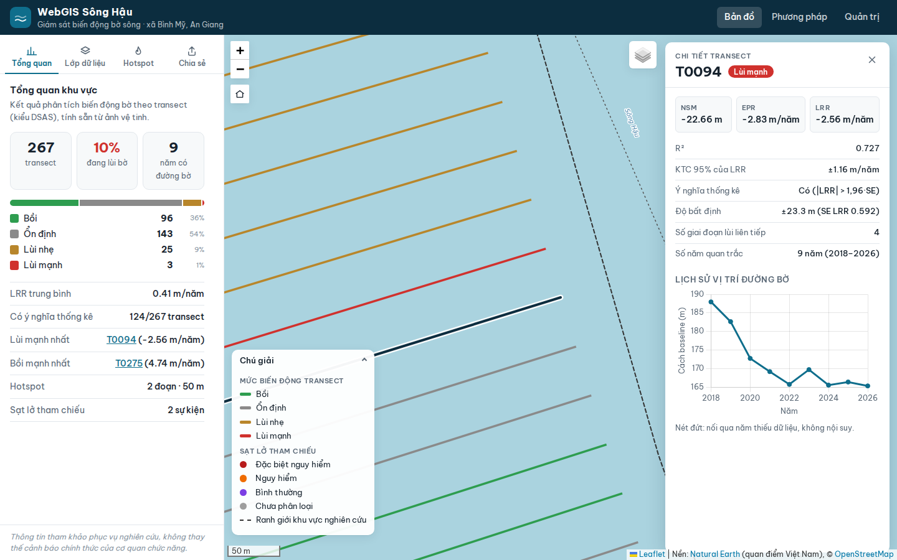
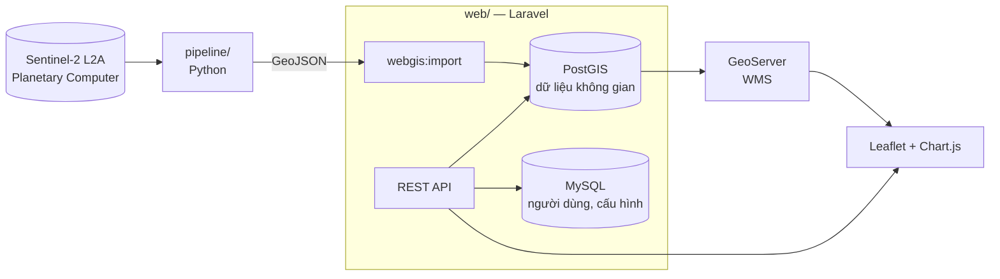

# WebGIS giám sát biến động bờ sông Hậu

[](https://github.com/nvs15122k4/web-gis/actions/workflows/ci.yml)


Hệ thống WebGIS theo dõi biến động đường bờ sông Hậu tại xã Bình Mỹ (An Giang) giai đoạn 2018–2026 từ ảnh vệ tinh
Sentinel-2: trích xuất đường bờ từng năm, tính tốc độ biến động trên transect (NSM, EPR, LRR, R²), phát hiện điểm
nóng xói lở và hiển thị trên bản đồ web tương tác.

## Tính năng

- **Bản đồ tương tác** — đường bờ theo năm, transect tô màu theo mức biến động, điểm nóng xói lở, sự kiện sạt lở tham chiếu (Leaflet + WMS GeoServer).
- **Phân tích transect** — biểu đồ chuỗi khoảng cách theo năm, chỉ số NSM/EPR/LRR/R² và độ bất định.
- **Tổng quan** — thống kê theo mức biến động, lọc điểm nóng theo ngưỡng, liên kết chia sẻ (permalink).
- **Xuất dữ liệu** — tải các lớp dưới dạng GeoJSON/CSV qua REST API.
- **Quản trị** — đăng nhập (Sanctum) để chỉnh ngưỡng hiển thị; mọi thay đổi được ghi nhật ký.

## Hình ảnh

Toàn bộ hình chỉ thể hiện khu vực đề tài — đoạn bờ sông Hậu thuộc xã Bình Mỹ, An Giang.

| | |
|---|---|
|  |  |
| Bản đồ tổng quan: 267 transect theo mức biến động | Chi tiết transect T0094: NSM/EPR/LRR/R², lịch sử vị trí đường bờ |

**Bản đồ chuyên đề** — thành lập bằng QGIS 3.40 (print layout, script PyQGIS [`pipeline/qgis_maps.py`](pipeline/qgis_maps.py)),
nền ảnh tổng hợp Sentinel-2, hệ toạ độ WGS 84 / UTM 48N, xuất 300 dpi:

| | | |
|---|---|---|
| [](docs/ban_do/vi_tri.png) | [](docs/ban_do/duong_bo.png) | [](docs/ban_do/phan_loai.png) |
| Vị trí khu vực nghiên cứu | Đường bờ 2018–2026 | Phân loại mức biến động |
| [](docs/ban_do/duong_bo_chi_tiet.png) | [](docs/ban_do/doi_chieu_2021.png) | |
| Điểm nóng xói lở mạnh nhất | Đối chiếu với ESA WorldCover 2021 | |

**Sơ đồ** (Mermaid): [kiến trúc](docs/assets/architecture.png) · [ERD PostGIS](docs/assets/er-postgis.png) ·
[ERD MySQL](docs/assets/er-mysql.png) · [tiến độ](docs/assets/gantt.png). Trang giới thiệu & phương pháp:
[ảnh](docs/minh_chung/03_trang_gioi_thieu.png).

## Kiến trúc



Web chỉ **đọc** kết quả: mọi chỉ số được pipeline tính sẵn, Laravel không tính lại.

## Cấu trúc thư mục

```
.
├── pipeline/   Xử lý ảnh Sentinel-2 → đường bờ, transect, thống kê (Python)
├── web/        Ứng dụng WebGIS: API, giao diện bản đồ, cấu hình GeoServer (Laravel)
├── e2e/        Kiểm thử đầu-cuối (Playwright)
└── .github/    CI và mẫu issue / pull request
```

| Thành phần | Công nghệ | Tài liệu |
|---|---|---|
| Pipeline | Python, rasterio, xarray, geopandas, scikit-image | [`pipeline/README.md`](pipeline/README.md) |
| Web | Laravel 13, PostGIS, MySQL, GeoServer, Leaflet, Chart.js, Tailwind CSS | [`web/README.md`](web/README.md) |
| E2E | Playwright (Chromium, Firefox, WebKit) | [`web/README.md#5-kiểm-thử`](web/README.md#5-kiểm-thử) |

## Bắt đầu nhanh

Yêu cầu: PHP ≥ 8.4, Composer, Node ≥ 20, Docker (hoặc MySQL 8 + PostgreSQL/PostGIS + GeoServer cài sẵn).

```bash
git clone git@github.com:nvs15122k4/web-gis.git && cd web-gis/web

docker compose up -d                       # MySQL :3307, PostGIS :5432, GeoServer :8080
composer install && npm install
cp .env.example .env && php artisan key:generate   # chỉnh DB_* và DB_PGSQL_*

php artisan migrate --seed
php artisan webgis:import ../pipeline/output       # nạp kết quả pipeline có sẵn trong repo
python3 geoserver/basemap/build_basemap.py         # nền bản đồ tự phục vụ (Natural Earth quan điểm VN + OSM)
geoserver/provision.sh songhau webgis_spatial      # workspace, store, style, layer, nền nen_ban_do

npm run build && php artisan serve                 # http://127.0.0.1:8000
```

Chạy lại pipeline từ ảnh gốc: xem [`pipeline/README.md`](pipeline/README.md).

## Kiểm thử

```bash
cd web && php artisan migrate --env=testing && php artisan test   # PHPUnit
cd e2e && npm ci && npx playwright test                           # Playwright E2E
```

CI trên GitHub Actions chạy PHPUnit (MySQL + PostGIS), build front-end và kiểm tra cú pháp pipeline cho mỗi push và pull request.

## Tài khoản kiểm thử

Tạo bởi seeder trong `web/database/seeders/` (mật khẩu chỉ dùng cho môi trường phát triển, đổi khi triển khai thật):

| Email | Mật khẩu | Vai trò | Nguồn | Ghi chú |
|---|---|---|---|---|
| `admin@webgis.test` | `password` | `admin` | `php artisan db:seed` (`DatabaseSeeder`) | Vào trang quản trị `/admin` để sửa ngưỡng hiển thị |
| `viewer@webgis.test` | `password` | `viewer` | `E2eFixtureSeeder` | Chỉ có trong CSDL kiểm thử/E2E, dùng cho kịch bản từ chối quyền |

`ThresholdConfigSeeder` nạp ngưỡng mặc định `min_erosion_rate = 1.0` (m/năm). `E2eFixtureSeeder` dựng dữ liệu tổng hợp cố định (10 transect T01–T10, 2018–2026, thiếu năm 2022) cho Playwright/PHPUnit, không dùng chung CSDL phát triển.
Đăng nhập sai 5 lần theo email hoặc IP sẽ bị khoá tạm (HTTP 429); token Sanctum hết hạn sau 480 phút (`SANCTUM_TOKEN_EXPIRATION`).

## Cấu trúc cơ sở dữ liệu

Hai CSDL, theo các migration trong `web/database/migrations/`.

**MySQL** (người dùng và cấu hình):

| Bảng | Cột chính |
|---|---|
| `users` | `id`, `name`, `email` (unique), `password`, `role` (`admin` \| `viewer`, mặc định `viewer`) |
| `threshold_configs` | `key` (unique), `value`, `description`, `updated_by` → `users` |
| `activity_logs` | `user_id` → `users`, `action`, `ip_address`, `created_at` |
| `personal_access_tokens` | token Sanctum |
| `sessions`, `password_reset_tokens`, `cache`, `jobs` | bảng hệ thống của Laravel |

**PostgreSQL/PostGIS** (không gian, hình học EPSG:4326, chỉ mục GiST trên `geom`; thư mục `migrations/pgsql/`):

| Bảng / view | Nội dung |
|---|---|
| `baseline` | đường cơ sở, `LineString` |
| `shorelines` | đường bờ theo năm, `MultiLineString`; `year`, `water_index`, `source_image_date`; unique `(year, water_index)` |
| `transects` | `transect_code` (unique), `baseline_id` → `baseline`, `geom` |
| `transect_shoreline_distances` | khoảng cách baseline → bờ `distance_m` theo `(transect_id, year)` |
| `shoreline_change_stats` | mỗi transect một dòng: `nsm_m`, `epr_m_per_year`, `lrr_m_per_year`, `se_lrr`, `r_squared`, `is_significant`, `change_class` (`accretion` \| `stable` \| `mild_erosion` \| `severe_erosion`), `consecutive_erosion_periods`, `u_shoreline_avg` |
| `erosion_hotspots` | đoạn lùi bờ mạnh: `severity` (m/năm), `period_start_year`, `period_end_year`, `notes` |
| `reference_landslide_events` | sạt lở tham chiếu: `event_date`, `description`, `source`, `danger_level` (`dac_biet_nguy_hiem` \| `nguy_hiem` \| `binh_thuong`), `length_m`, `location` |
| `transects_styled` (view) | `transects` ghép `shoreline_change_stats`, dùng cho GeoServer (lọc `is_significant` bằng CQL_FILTER) |

## Kết quả thực nghiệm

Trích từ `pipeline/output/*.json` (bản demo, sinh bởi pipeline).

**Tổng quan** (`summary.json`): 267 transect, chỉ số nước đang dùng `mndwi`, 13 quan sát bị khử đột biến, 2 hotspot.

| Lớp biến động | Số transect |
|---|---|
| Bồi (`accretion`) | 96 |
| Ổn định (`stable`) | 143 |
| Lùi nhẹ (`mild_erosion`) | 25 |
| Lùi mạnh (`severe_erosion`) | 3 |

Ngưỡng lùi mạnh = M − S = −1,804 m/năm (M = −1,356; S = 0,448 theo LRR của các transect lùi bờ).
Hotspot (`hotspots.json`, giai đoạn 2018–2026): đoạn T0094–T0095 (2 transect, ~100 m, 2,21 m/năm) và T0138 (1 transect, ~50 m, 1,83 m/năm).
Độ bất định đường bờ `u_shoreline` theo năm: 19,93 m (2018), 22,52 m (2022), 23,85 m (các năm còn lại); `u_classify_is_placeholder = false`.

**Đánh giá so với ground truth số hoá** (`evaluation.json`, 5 ô mẫu mỗi năm, 18.000 pixel/chỉ số). Giá trị F1 / IoU:

| Năm | NDWI | MNDWI | AWEI |
|---|---|---|---|
| 2018 | 0,9483 / 0,9017 | 0,9465 / 0,8984 | 0,9430 / 0,8922 |
| 2022 | 0,9366 / 0,8807 | 0,9493 / 0,9035 | 0,9450 / 0,8957 |
| 2026 | 0,9345 / 0,8770 | 0,9411 / 0,8887 | 0,9491 / 0,9032 |
| F1 trung bình 3 năm | 0,9398 | 0,9456 | 0,9457 |

Chỉ số tốt nhất theo F1 trung bình: `awei` (`best_index_by_mean_f1`), hơn `mndwi` không đáng kể (0,9457 so với 0,9456). Sai số đường bờ so với ground truth:

| Năm | Số transect | Sai số TB (m) | Sai số tuyệt đối TB (m) | RMSE (m) |
|---|---|---|---|---|
| 2018 | 58 | 1,58 | 9,23 | 15,10 |
| 2022 | 58 | 0,80 | 11,38 | 18,39 |
| 2026 | 59 | 4,01 | 13,45 | 19,99 |

RMSE này là gợi ý `U_classify` (15,1 / 18,39 / 19,99 m).

**Đối chiếu chéo** (`crosscheck.json`) với sản phẩm phủ bề mặt độc lập WorldCover (2020–2021) và IO-LULC (2018–2023). Chỉ để kiểm tra độ hợp lý, không thay ground truth và không dùng điền `U_CLASSIFY`. F1 trung bình toàn bộ: NDWI 0,8582, MNDWI 0,8765, AWEI 0,8810 (tốt nhất: `awei`). Độ lệch đường bờ RMSE: 46,92–70,66 m, cao hơn nhiều so với ground truth số hoá vì sản phẩm đối chiếu chỉ chính xác ~75–85%.

| Nguồn | Năm | F1 MNDWI | F1 AWEI | RMSE đường bờ (m) |
|---|---|---|---|---|
| WorldCover | 2020 | 0,8918 | 0,9063 | 70,66 |
| WorldCover | 2021 | 0,9179 | 0,9201 | 60,53 |
| IO-LULC | 2018 | 0,8569 | 0,8249 | 46,92 |
| IO-LULC | 2019 | 0,7844 | 0,7926 | 49,67 |
| IO-LULC | 2020 | 0,8943 | 0,9038 | 59,92 |
| IO-LULC | 2021 | 0,8959 | 0,9093 | 52,29 |
| IO-LULC | 2022 | 0,8837 | 0,8917 | 51,92 |
| IO-LULC | 2023 | 0,8871 | 0,8993 | 51,07 |

## Dữ liệu

Dữ liệu trong `pipeline/output/` và `pipeline/data/` là **bản demo** phục vụ phát triển. Độ bất định phân loại (U_classify)
lấy theo RMSE đường bờ so với ground truth số hoá trên 5 ô mẫu (2018, 2022, 2026); các năm còn lại dùng giá trị lớn nhất đã đo.
Kết quả đánh giá nằm ở `pipeline/output/evaluation.json`.
Ảnh Sentinel-2: © Copernicus / ESA, truy cập qua Microsoft Planetary Computer.

## Tác giả

Nguyễn Văn Sang — đồ án tốt nghiệp.
