# WebGIS giám sát biến động bờ sông Hậu

[](https://github.com/nvs15122k4/web-gis/actions/workflows/ci.yml)


Hệ thống WebGIS theo dõi biến động đường bờ sông Hậu tại xã Bình Mỹ (An Giang) giai đoạn 2018–2026 từ ảnh vệ tinh
Sentinel-2: trích xuất đường bờ từng năm, tính tốc độ biến động trên transect (NSM, EPR, LRR, R²), phát hiện điểm
nóng xói lở và hiển thị trên bản đồ web tương tác.

## Tính năng

Ứng dụng web (Laravel + Leaflet + Chart.js) gồm các trang sau; ảnh chụp từ bản chạy thật trên dữ liệu pipeline (266 transect).

| Đường dẫn | Quyền | Nội dung |
|---|---|---|
| `/` | công khai | Bản đồ tương tác với 4 thẻ: **Tổng quan** (thống kê, chú giải, dải năm), **Lớp dữ liệu** (bật/tắt lớp, đường bờ từng năm, so sánh hai năm), **Hotspot** (lọc theo tốc độ lùi bờ), **Chia sẻ** (liên kết, tải GeoJSON/CSV); bấm một transect để xem NSM, EPR, LRR, R², khoảng tin cậy và biểu đồ lịch sử |
| `/gioi-thieu` | công khai | Mục tiêu, quy trình xử lý ảnh từng bước, nguồn dữ liệu, phương pháp DSAS (NSM, EPR, LRR, R²), tiêu chí phân loại 4 mức, công thức độ bất định, sạt lở tham chiếu, hạn chế khi sử dụng, liên kết WMS/WFS và tài liệu tham khảo |
| `/huong-dan` | công khai | Hướng dẫn từng bước: bắt đầu, dùng từng thẻ, xem chi tiết transect, so sánh hai năm, chia sẻ/tải dữ liệu, cách đọc kết quả cho đúng, phím tắt và hỗ trợ tiếp cận, hỏi đáp |
| `/dang-nhap` | công khai | Đăng nhập bằng phiên (khoá tạm 60 giây sau 5 lần sai theo email hoặc IP, trả HTTP 429) |
| `/admin` | `admin` | Sửa ngưỡng hiển thị hotspot `min_erosion_rate` (m/năm); mọi thay đổi ghi vào `activity_logs` kèm người sửa và địa chỉ IP |
| `/bao-cao` | `admin` | Báo cáo nội bộ: số liệu chung, tiến độ theo đề cương, mốc thời gian, kết quả kiểm thử |
| `/api/*` | công khai (trừ ghi) | REST trả GeoJSON/JSON hệ toạ độ EPSG:4326; ghi dữ liệu cần token Sanctum của `admin`; xem bảng bên dưới |

### Bản đồ

Ảnh chụp giao diện **v3** (thư mục `docs/minh_chung/giao_dien_moi_v3/`).

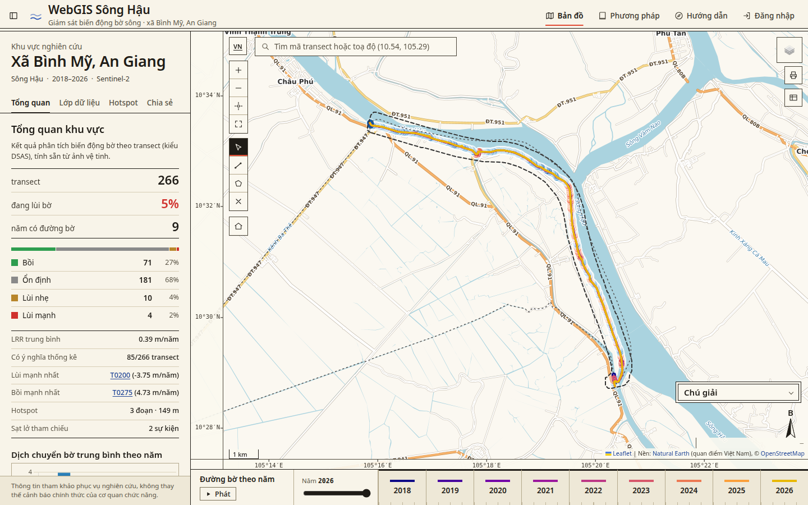

*Thẻ **Tổng quan** (cột bên trái): 266 transect theo mức biến động (bồi / ổn định / lùi nhẹ / lùi mạnh), tỉ lệ đang lùi bờ, LRR trung bình, số transect có ý nghĩa thống kê,
transect lùi/bồi mạnh nhất (bấm mã để phóng tới), hotspot, sạt lở tham chiếu và biểu đồ dịch chuyển bờ trung bình theo năm. Trên bản đồ: ô tìm mã transect hoặc toạ độ,
thanh công cụ (phóng to/thu nhỏ, định vị, toàn khung, chọn, đo đường, đo diện tích, xoá), nút lớp nền, **in bản đồ** và **bảng thuộc tính**, chú giải thu gọn ở góc dưới phải, dải năm 2018–2026 ở đáy
(bấm một năm để bật/tắt đường bờ, nút **Phát** chạy lần lượt). Lần đầu vào có hộp gợi ý ngắn. Nền bản đồ tự phục vụ trên GeoServer.*

| | |
|---|---|
| 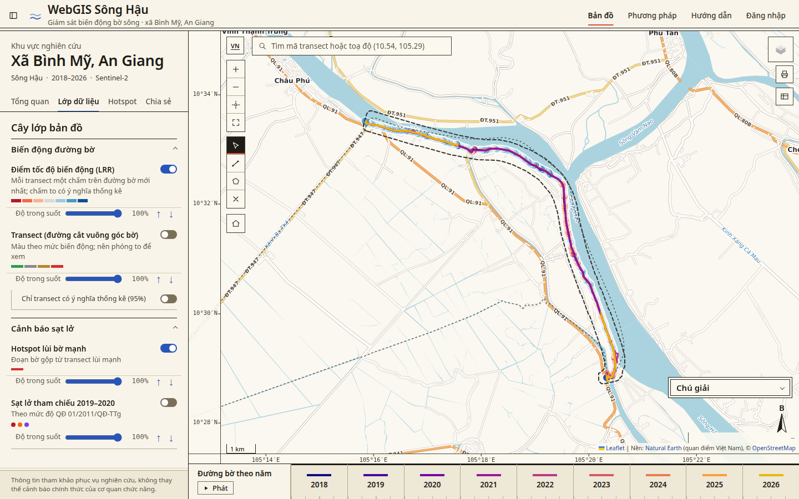 | 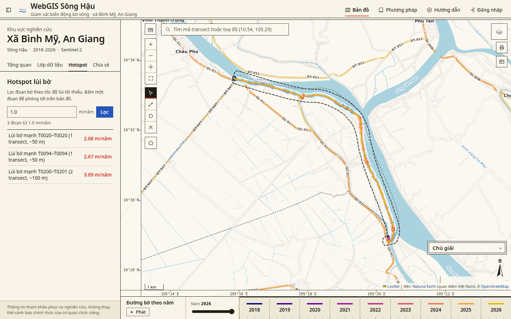 |
| **Lớp dữ liệu**: cây lớp chia nhóm (Biến động đường bờ, Cảnh báo sạt lở); mỗi lớp có công tắc, độ mờ và nút đưa lên/xuống; lớp *điểm tốc độ biến động (LRR)* bật sẵn, *transect* bật khi cần (có lọc "chỉ transect có ý nghĩa thống kê 95%") | **Hotspot**: lọc đoạn lùi bờ theo tốc độ tối thiểu (m/năm), bấm một đoạn để phóng tới |
| 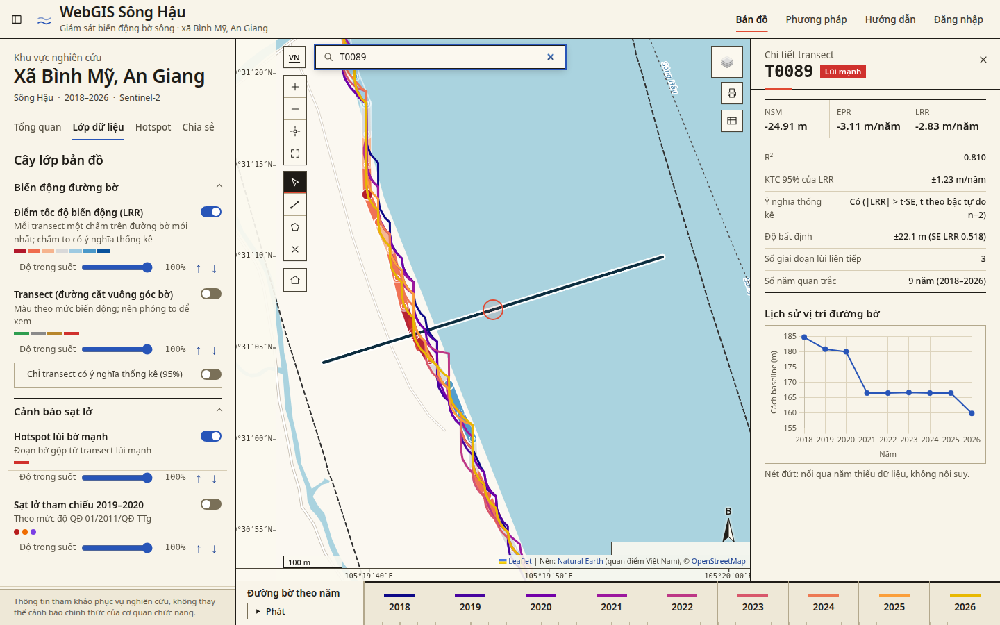 | 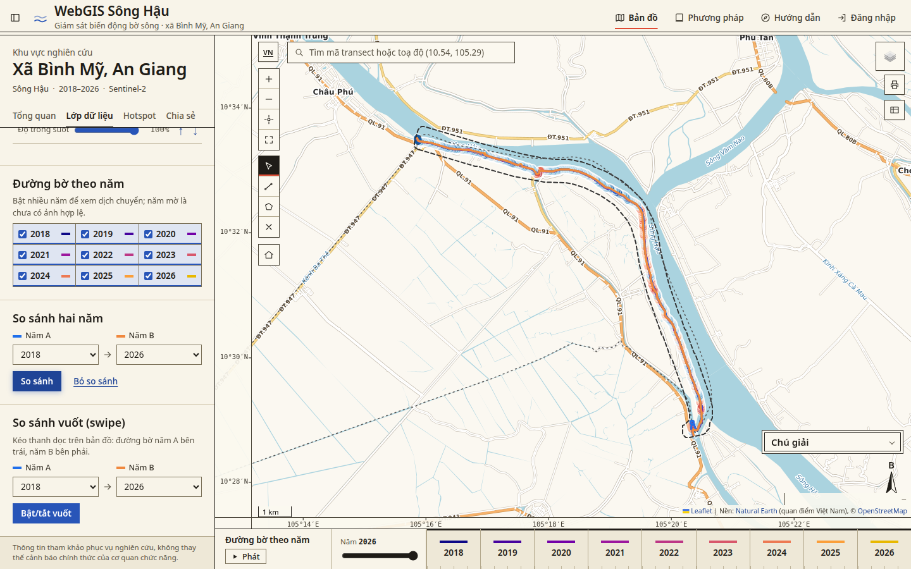 |
| **Chi tiết transect T0094** (mở bằng tìm kiếm hoặc bấm trên bản đồ): NSM, EPR, LRR, R², khoảng tin cậy 95%, ý nghĩa thống kê, độ bất định, số giai đoạn lùi liên tiếp, biểu đồ lịch sử vị trí đường bờ | **So sánh hai năm** (2018 – 2026): chồng hai đường bờ; ngoài ra có **so sánh vuốt (swipe)** kéo thanh dọc để xem năm A bên trái, năm B bên phải |

- **Chia sẻ & xuất dữ liệu** — thẻ **Chia sẻ**: liên kết lưu khung nhìn, lớp, năm trong URL (`#map=…`); tải từng lớp dạng GeoJSON/CSV tại `/api/export/{lớp}.{geojson|csv}`; ảnh ở `04_tab_chia_se.png`.
- **Giao diện di động** — bảng điều khiển và chi tiết transect thành ngăn kéo phía dưới, thanh điều hướng chia đều một hàng, xem [ảnh](docs/minh_chung/giao_dien_moi_v3/13_di_dong.png).
- **Thanh điều hướng** — *Bản đồ*, *Phương pháp* (`/gioi-thieu`), *Hướng dẫn*, *Đăng nhập*; trang phụ và trang lỗi 403/404 có icon, đăng nhập qua tài khoản demo cấu hình bằng biến môi trường `DEMO_*`.
- **Tốc độ tải** — các năm dùng chung một lớp WMS, Chart.js chỉ tải khi biểu đồ hiện ra.

### Các trang còn lại

Ba trang dài nên mỗi ảnh chụp được cắt thành các phần theo thứ tự từ trên xuống.

**`/gioi-thieu` — phương pháp và hạn chế.** Mục lục bên trái; mục tiêu, dữ liệu Sentinel-2; mục **Từ ảnh vệ tinh đến đường bờ và tốc độ biến động** gồm các bước quy trình đánh số (thu thập và lọc cảnh, composite, làm nổi mặt nước bằng chỉ số, hình thái học, …), mỗi bước có ảnh minh hoạ từ dữ liệu thật của pipeline và nút *Chi tiết kỹ thuật*; sau đó là chuỗi phân tích DSAS (NSM, EPR, LRR, R²), tiêu chí phân loại, độ bất định, sạt lở tham chiếu, hạn chế, liên kết WMS/WFS và tài liệu tham khảo.

| Phần 1 | Phần 2 |
|---|---|
| 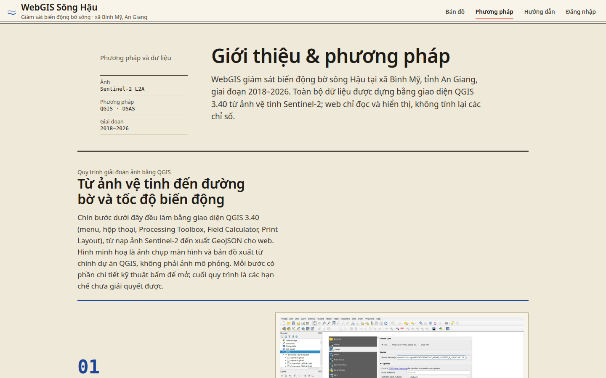 | 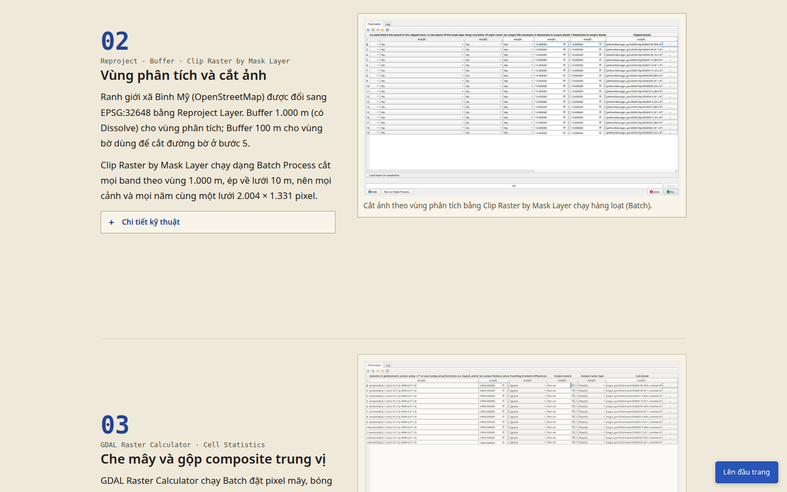 |
| 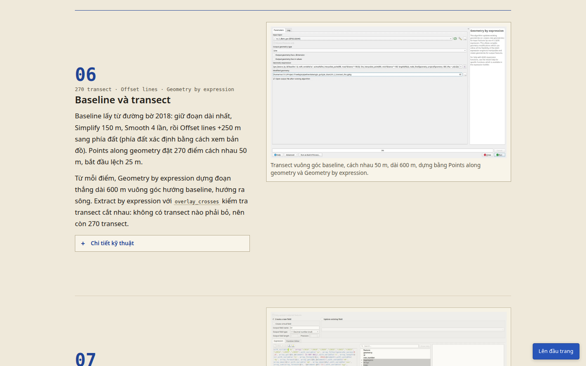 | 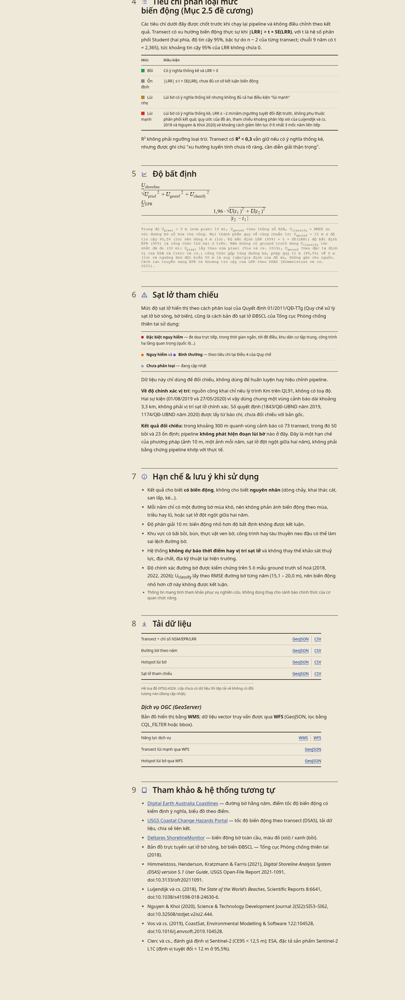 |

**`/huong-dan` — hướng dẫn sử dụng.** Nửa trên: bắt đầu nhanh, thẻ Tổng quan, Lớp dữ liệu, xem chi tiết transect. Nửa dưới: Hotspot, so sánh hai năm, chia sẻ/tải dữ liệu, đọc kết quả, phím tắt, hỏi đáp.

| Nửa trên | Nửa dưới |
|---|---|
| 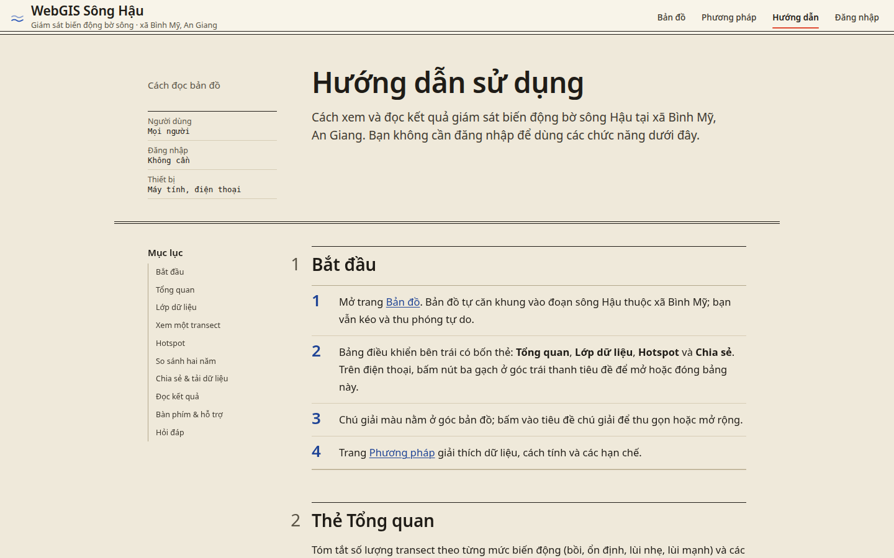 | 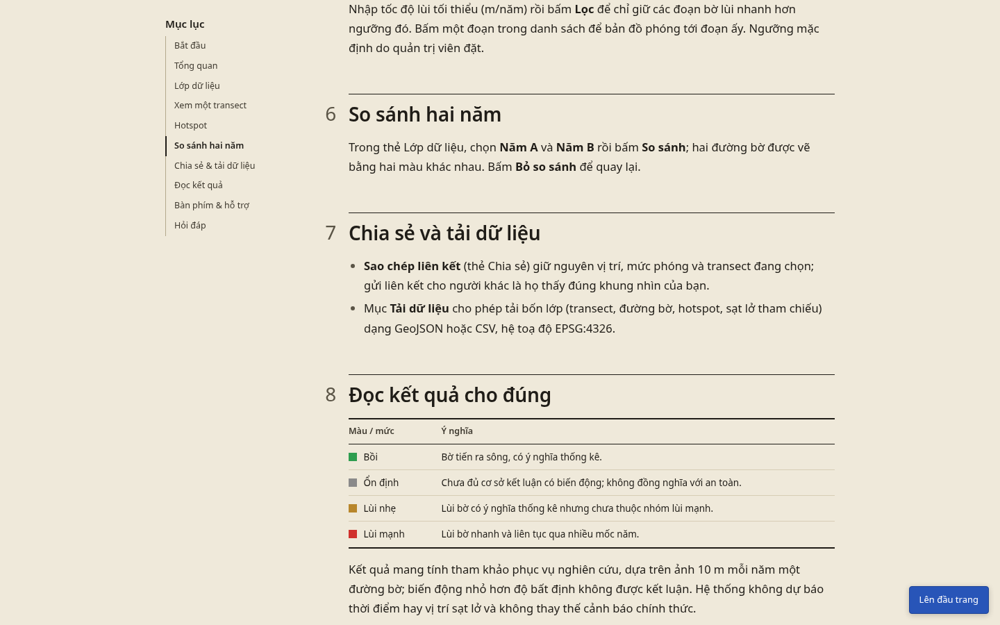 |

**`/bao-cao` — báo cáo nội bộ (cần quyền `admin`).** Đối chiếu công việc đã làm với đề cương, số liệu chung và kết quả kiểm thử.

| Nửa trên | Nửa dưới |
|---|---|
| 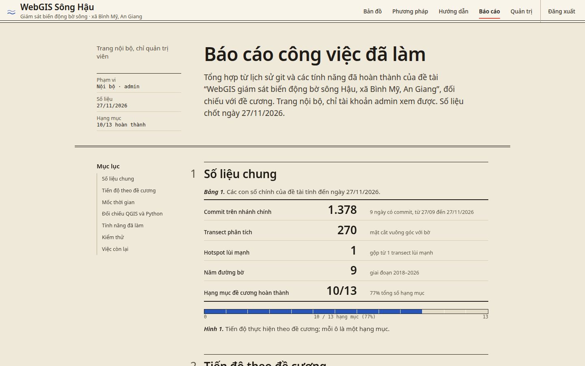 | 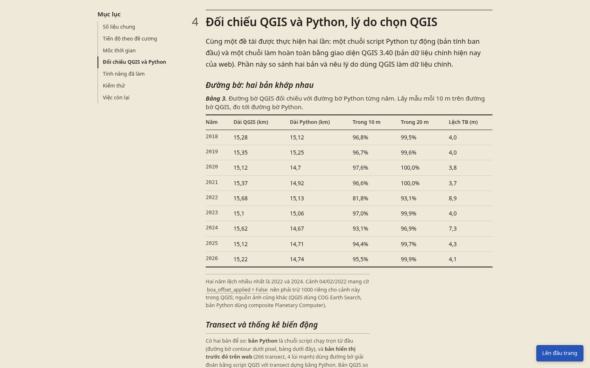 |

**`/admin` — quản trị ngưỡng (cần quyền `admin`).** Đổi `min_erosion_rate` (m/năm); ngưỡng này chỉ lọc hotspot hiển thị, không đổi phân loại của pipeline. Tài khoản `viewer` bị từ chối (HTTP 403).

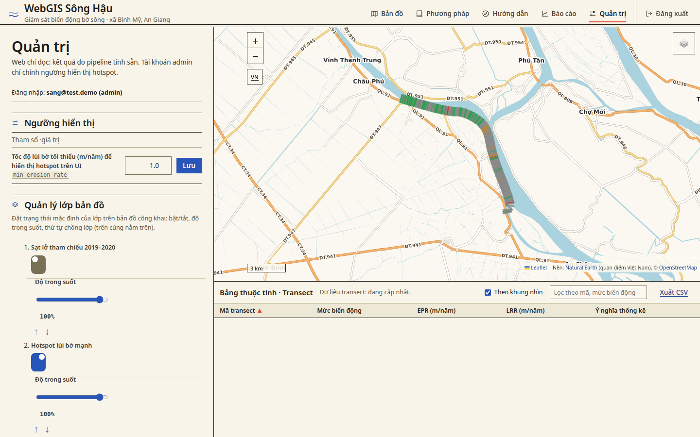

### REST API

| Phương thức | Đường dẫn | Mô tả |
|---|---|---|
| GET | `/api/status` | Tình trạng MySQL, PostGIS, GeoServer và số bản ghi |
| GET | `/api/summary` | Thống kê theo mức biến động, transect lùi/bồi mạnh nhất, hotspot, sạt lở tham chiếu |
| GET | `/api/shorelines` | Đường bờ theo năm |
| GET | `/api/transects`, `/api/transects/{id}`, `/api/transects/{id}/history` | Transect, chi tiết, chuỗi khoảng cách theo năm |
| GET | `/api/erosion-hotspots` | Đoạn lùi bờ mạnh |
| GET | `/api/reference-events` | Sạt lở tham chiếu 2019–2020 |
| GET | `/api/config/thresholds` | Ngưỡng hiển thị hiện hành |
| GET | `/api/export/{lớp}.{geojson\|csv}` | Tải dữ liệu |
| POST | `/api/auth/login` | Cấp token Sanctum |
| PUT | `/api/admin/config/thresholds/{key}` | Sửa ngưỡng (`admin`) |

## Bản đồ chuyên đề và sơ đồ

Bản đồ chuyên đề thành lập bằng QGIS 3.40 (print layout, script PyQGIS [`pipeline/qgis_maps.py`](pipeline/qgis_maps.py)),
nền ảnh tổng hợp Sentinel-2, hệ toạ độ WGS 84 / UTM 48N, xuất 300 dpi. Toàn bộ hình chỉ thể hiện khu vực đề tài —
đoạn bờ sông Hậu thuộc xã Bình Mỹ, An Giang.

| | | |
|---|---|---|
| [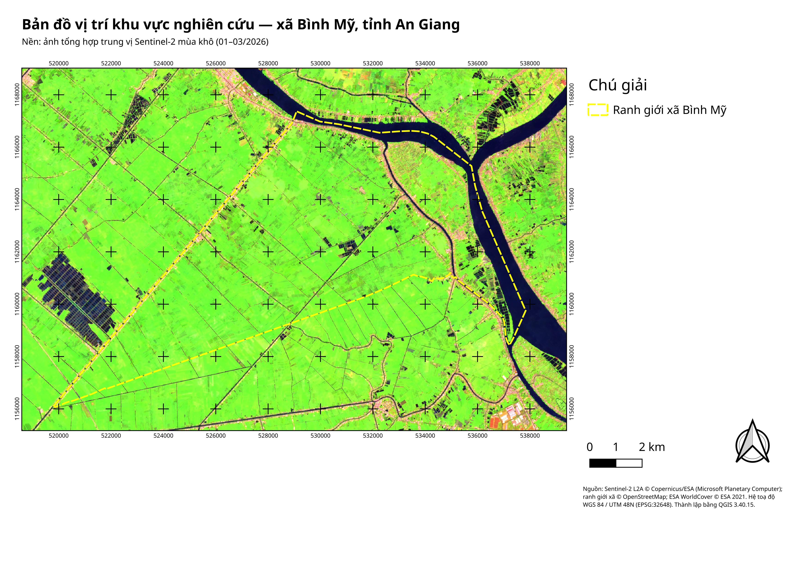](docs/ban_do/vi_tri.png) | [](docs/ban_do/duong_bo.png) | [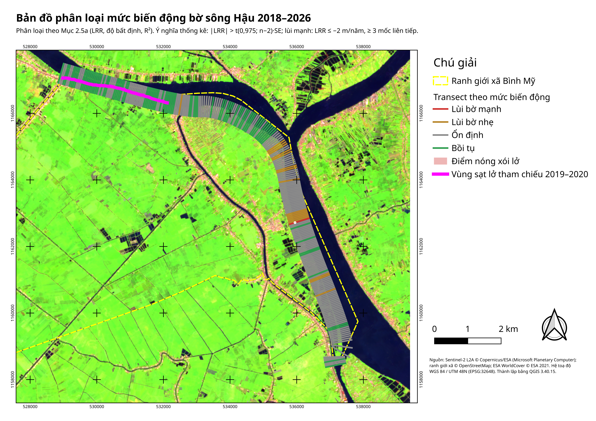](docs/ban_do/phan_loai.png) |
| Vị trí khu vực nghiên cứu | Đường bờ 2018–2026 | Phân loại mức biến động |
| [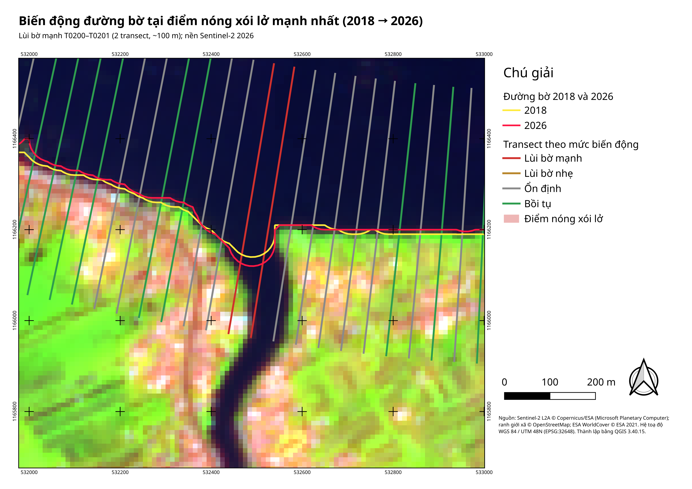](docs/ban_do/duong_bo_chi_tiet.png) | [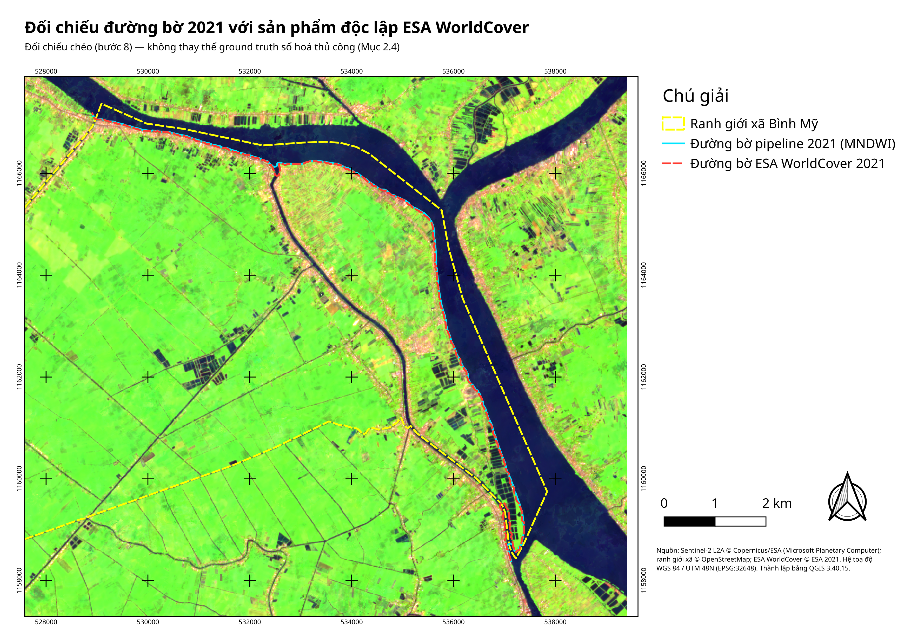](docs/ban_do/doi_chieu_2021.png) | |
| Điểm nóng xói lở mạnh nhất | Đối chiếu với ESA WorldCover 2021 | |

**Sơ đồ** (Mermaid): [kiến trúc](docs/assets/architecture.png) · [ERD PostGIS](docs/assets/er-postgis.png) ·
[ERD MySQL](docs/assets/er-mysql.png) · [tiến độ](docs/assets/gantt.png).

## Kiến trúc

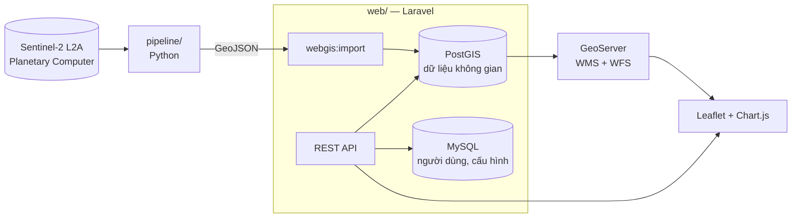

Web chỉ **đọc** kết quả: mọi chỉ số được pipeline tính sẵn, Laravel không tính lại.

## Cấu trúc thư mục

```
.
├── pipeline/   Xử lý ảnh Sentinel-2 → đường bờ, transect, thống kê (Python)
├── web/        Ứng dụng WebGIS: API, giao diện bản đồ, cấu hình GeoServer (Laravel)
├── e2e/        Kiểm thử đầu-cuối (Playwright)
└── .github/    CI và mẫu issue / pull request
```

| Thành phần | Công nghệ | Tài liệu |
|---|---|---|
| Pipeline | Python, rasterio, xarray, geopandas, scikit-image | [`pipeline/README.md`](pipeline/README.md) |
| Web | Laravel 13, PostGIS, MySQL, GeoServer, Leaflet, Chart.js, Tailwind CSS | [`web/README.md`](web/README.md) |
| E2E | Playwright (Chromium, Firefox, WebKit) | [`web/README.md#5-kiểm-thử`](web/README.md#5-kiểm-thử) |

## Cài đặt nhanh

Yêu cầu: PHP ≥ 8.4, Composer, Node ≥ 20, Docker (hoặc MySQL 8 + PostgreSQL/PostGIS + GeoServer cài sẵn).

```bash
git clone git@github.com:nvs15122k4/web-gis.git && cd web-gis/web

docker compose up -d                       # MySQL :3307, PostGIS :5432, GeoServer :8080
composer install && npm install
cp .env.example .env && php artisan key:generate
# Mở .env, bỏ comment khối "Chế độ cục bộ (docker compose)" ở cuối file rồi xoá/ghi đè các dòng DB_PGSQL_* mặc định (Supabase)

php artisan migrate --seed
php artisan webgis:import ../pipeline/output       # nạp kết quả pipeline có sẵn trong repo
set -a && . ./.env && set +a                  # build_basemap.py và provision.sh đọc DB_PGSQL_* từ môi trường
python3 geoserver/basemap/build_basemap.py         # nền bản đồ tự phục vụ (Natural Earth quan điểm VN + OSM)
geoserver/provision.sh songhau webgis_spatial      # workspace, store, style, layer, nền nen_ban_do

npm run build && php artisan serve                 # http://127.0.0.1:8000
```

> Docker compose chiếm cổng 5432 và 8080; nếu máy đã chạy sẵn PostgreSQL/GeoServer, hãy dừng chúng hoặc đổi cổng trong `docker-compose.yml` và `.env`.

Chỉ cần xem giao diện, không dùng GeoServer: bỏ hai lệnh `build_basemap.py` / `provision.sh`, để trống `GEOSERVER_URL` — bản đồ vẽ GeoJSON từ `/api/*`.
Muốn có sẵn tài khoản demo, điền `DEMO_*` trong `.env` trước khi `db:seed` rồi đăng nhập tại `/dang-nhap` (xem mục [Tài khoản kiểm thử](#tài-khoản-kiểm-thử)).

Chạy lại pipeline từ ảnh gốc: xem [`pipeline/README.md`](pipeline/README.md) và mục [Tái lập kết quả thực nghiệm](#tái-lập-kết-quả-thực-nghiệm).

## Kiểm thử

```bash
cd pipeline && .venv/bin/python -m pytest -q                      # pytest: thống kê, phân loại, độ bất định, dữ liệu mẫu
cd web && npm run test:js                                         # vitest: JavaScript giao diện
cd web && php artisan migrate --env=testing && php artisan test   # PHPUnit
cd e2e && npm ci && npx playwright test                           # Playwright E2E
```

Số liệu các lần chạy được ghi ở [`docs/minh_chung/ketqua_e2e.txt`](docs/minh_chung/ketqua_e2e.txt).

### Chạy E2E song song nhiều phiên

Mặc định E2E dùng cổng 8010 và CSDL `webgis_app_e2e`; hai phiên chạy cùng lúc sẽ đè ngưỡng của nhau (ca `AD09` từng flaky vì lý do này). Đặt `E2E_SLOT=<tên>` (a-z, 0-9, `_`) để mỗi phiên có cổng và CSDL MySQL riêng (`webgis_app_e2e_<tên>`, tự tạo), ví dụ `E2E_SLOT=a npx playwright test`. PostGIS và GeoServer dùng chung (dữ liệu cố định, chỉ nạp khi còn trống); kết quả nằm ở `e2e/test-results-<tên>/` và `e2e/playwright-report-<tên>/`.

### Phân loại kiểm thử E2E

Mỗi kiểm thử Playwright mang tag theo cách chia chuẩn; một kiểm thử có thể có nhiều tag.

| Tag | Mục đích | Lệnh (trong `e2e/`) |
|---|---|---|
| `@smoke` | Kiểm thử khói: trang chính, API, đăng nhập có chạy không (nhanh, không retry) | `npm run test:smoke` |
| `@sanity` | Kiểm thử tỉnh táo: chức năng lõi vừa sửa còn hợp lý | `npm run test:sanity` |
| `@happy` | Luồng chuẩn: người dùng làm đúng, kết quả thành công | `npm run test:happy` |
| `@negative` | Đầu vào sai, thiếu quyền, hệ thống phụ lỗi → phải bị từ chối đúng cách | `npm run test:negative` |
| `@edge` | Ngoại lệ & biên: ngưỡng 0, năm/transect thiếu dữ liệu, hash URL hỏng | `npm run test:edge` |
| `@regression` | Hồi quy: số liệu UI khớp API, chia sẻ liên kết, console sạch, phân quyền | `npm run test:regression` (3 trình duyệt) |

Tag phi chức năng: `@a11y`, `@responsive`, `@performance`, `@security`, `@resilience` (script `npm run test:<tag>`). Kết quả mỗi nhóm nằm trong [`docs/minh_chung/ketqua_e2e.txt`](docs/minh_chung/ketqua_e2e.txt).

PHPUnit dùng CSDL riêng `webgis_app_test` và `webgis_spatial_test` (tạo trước, cùng tài khoản với `.env`); `phpunit.xml` đã đặt sẵn `APP_ENV=testing`, `APP_DEBUG=false`, không cần `.env.testing`.

CI trên GitHub Actions chạy PHPUnit (MySQL + PostGIS), build front-end và kiểm tra cú pháp pipeline cho mỗi push và pull request.

## Tài khoản kiểm thử

Mật khẩu **không** ghi trong repo công khai. Hai tài khoản demo do `DemoAccountsSeeder` (gọi từ `DatabaseSeeder`) tạo từ biến môi trường trong `web/.env` (đã `.gitignore`); thiếu biến nào thì bỏ qua tài khoản đó:

| Vai trò | Biến môi trường | Quyền |
|---|---|---|
| `admin` | `DEMO_ADMIN_EMAIL`, `DEMO_ADMIN_PASSWORD` | Xem bản đồ, vào `/admin` sửa ngưỡng, xem `/bao-cao`, gọi API ghi |
| `viewer` | `DEMO_USER_EMAIL`, `DEMO_USER_PASSWORD` | Đăng nhập được nhưng bị từ chối ở `/admin`, `/bao-cao` và API ghi (HTTP 403) |

```bash
# điền 4 biến DEMO_* trong web/.env (mẫu ở .env.example), rồi:
php artisan db:seed --class=DemoAccountsSeeder    # chạy lại an toàn (updateOrCreate theo email)
```

Cần cấp mật khẩu cho giảng viên/người xem thì gửi riêng, không đưa vào repo hay README. Nếu nghi ngờ mật khẩu đã lộ, đổi giá trị trong `.env` và chạy lại lệnh trên.

Tài khoản cố định của bộ kiểm thử tự động (`admin@webgis.test`, `viewer@webgis.test`) chỉ tồn tại trong CSDL phát triển/kiểm thử cục bộ qua `DatabaseSeeder`/`E2eFixtureSeeder`; `DatabaseSeeder` tự bỏ qua tài khoản `admin@webgis.test` khi `APP_ENV=production`.

`ThresholdConfigSeeder` nạp ngưỡng mặc định `min_erosion_rate = 1.0` (m/năm). `E2eFixtureSeeder` dựng dữ liệu tổng hợp cố định (10 transect T01–T10, 2018–2026, thiếu năm 2022) cho Playwright/PHPUnit, không dùng chung CSDL phát triển.
Đăng nhập sai 5 lần theo email hoặc IP sẽ bị khoá tạm (HTTP 429); token Sanctum hết hạn sau 480 phút (`SANCTUM_TOKEN_EXPIRATION`).

## Cấu trúc cơ sở dữ liệu

Hai CSDL, theo các migration trong `web/database/migrations/`.

**MySQL** (người dùng và cấu hình):

| Bảng | Cột chính |
|---|---|
| `users` | `id`, `name`, `email` (unique), `password`, `role` (`admin` \| `viewer`, mặc định `viewer`) |
| `threshold_configs` | `key` (unique), `value`, `description`, `updated_by` → `users` |
| `activity_logs` | `user_id` → `users`, `action`, `ip_address`, `created_at` |
| `personal_access_tokens` | token Sanctum |
| `sessions`, `password_reset_tokens`, `cache`, `jobs` | bảng hệ thống của Laravel |

**PostgreSQL/PostGIS** (không gian, hình học EPSG:4326, chỉ mục GiST trên `geom`; thư mục `migrations/pgsql/`):

| Bảng / view | Nội dung |
|---|---|
| `baseline` | đường cơ sở, `LineString` |
| `shorelines` | đường bờ theo năm, `MultiLineString`; `year`, `water_index`, `source_image_date`; unique `(year, water_index)` |
| `transects` | `transect_code` (unique), `baseline_id` → `baseline`, `geom` |
| `transect_shoreline_distances` | khoảng cách baseline → bờ `distance_m` theo `(transect_id, year)` |
| `shoreline_change_stats` | mỗi transect một dòng: `nsm_m`, `epr_m_per_year`, `lrr_m_per_year`, `se_lrr`, `unc_lrr` (nửa bề rộng KTC 95% của LRR, Student t df = n − 2), `r_squared`, `is_significant`, `change_class` (`accretion` \| `stable` \| `mild_erosion` \| `severe_erosion`), `consecutive_erosion_periods`, `u_shoreline_avg` |
| `erosion_hotspots` | đoạn lùi bờ mạnh: `severity` (m/năm), `period_start_year`, `period_end_year`, `notes` |
| `reference_landslide_events` | sạt lở tham chiếu: `event_date`, `description`, `source`, `danger_level` (`dac_biet_nguy_hiem` \| `nguy_hiem` \| `binh_thuong`), `length_m`, `location` |
| `transects_styled` (view) | `transects` ghép `shoreline_change_stats`, dùng cho GeoServer (lọc `is_significant` bằng CQL_FILTER) |

## Kết quả thực nghiệm

Trích từ `pipeline/output/*.json` (bản demo, sinh bởi pipeline).

**Tổng quan** (`summary.json`): 266 transect, chỉ số nước đang dùng `mndwi`, 9 quan sát bị khử đột biến, 3 hotspot. Đường bờ chính do QGIS tự giải đoán từ ảnh (`config.SHORELINE_ENGINE = "qgis"`, `qgis_interpret.py`); bản Python cũ (contour dưới pixel) giữ ở `data/shoreline_python/` làm mốc đối chiếu.

| Lớp biến động | Số transect |
|---|---|
| Bồi (`accretion`) | 71 |
| Ổn định (`stable`) | 181 |
| Lùi nhẹ (`mild_erosion`) | 10 |
| Lùi mạnh (`severe_erosion`) | 4 |

Tiêu chí chốt trước khi chạy lại (không chỉnh theo kết quả): có ý nghĩa thống kê khi |LRR| > t(0,975; n − 2)·SE (n = 9 năm thì t = 2,365);
lùi mạnh khi có ý nghĩa, LRR ≤ −2 m/năm và khoảng cách giảm liên tục ≥ 3 mốc năm liền nhau; R² &lt; 0,3 chỉ là cờ chất lượng.
Trước đó dùng z = 1,96 và ngưỡng M − S = −1,804 m/năm (tính trên chính kết quả, hậu nghiệm): 124 transect có ý nghĩa, 3 lùi mạnh, 2 hotspot.
Hotspot (`hotspots.json`, giai đoạn 2018–2026): 3 đoạn — T0020 (1 transect, LRR −2,68 m/năm), T0094 (1 transect, −2,67 m/năm), T0200–T0201 (2 transect, ~100 m, −3,09 m/năm).
So với bản Python cũ (267 transect, 1 lùi mạnh, 1 hotspot T0094), số lùi mạnh tăng do đường bờ QGIS đi theo cạnh pixel 10 m còn Python nội suy dưới pixel, nên các transect sát ngưỡng −2 m/năm đổi nhóm; LRR hai bản tương quan r = 0,95 (`output/qgis_interpret.json`). Đây là sai khác phương pháp cỡ một pixel, không phải thay đổi thực địa.
Hai chỗ lệch hình học đã kiểm tra:
- Khoảng cách Hausdorff 133 m giữa bản QGIS và Python năm 2019 là đầu một kênh rộng ~130 m tại (537090; 1158790): QGIS đóng đầu kênh bằng cung tròn (hệ quả của buffer ∓50 m), Python cắt phẳng cách đó ~125 m. Đây là hai cách xử lý miệng kênh khác nhau, không phải lỗi của bên nào.
- Từng có đoạn bờ giả 450–640 m ở bản đối chứng Sentinel-2 C1 2019 và Landsat 2021: đó là rìa vùng không có dữ liệu (mặt nạ mây), không phải bờ thật. Chuỗi QGIS nay lấp cụm no-data nhỏ (`gdal:fillnodata`) và cắt đoạn bờ trong 2 pixel quanh cụm từ 25 pixel (như `s3_shoreline`); đường bờ chính không đổi, Landsat 2021 hết đoạn thừa, Sentinel-2 C1 2019 bị cắt thành 3 đoạn vì thiếu dữ liệu quá lớn (năm này đã bị loại khỏi biến thể "tin cậy").
Độ bất định đường bờ `u_shoreline` (1σ, U_georef quy từ 12 m ở 95,5% về 6 m) theo năm: 18,46 m (2018), 19,46 m (2022), 23,06 m (các năm còn lại; 2026: 23,05 m).

**Đánh giá so với ground truth số hoá** (`evaluation.json`, 5 ô mẫu mỗi năm, 18.000 pixel/chỉ số). Giá trị F1 / IoU:

| Năm | NDWI | MNDWI | AWEI |
|---|---|---|---|
| 2018 | 0,9483 / 0,9017 | 0,9465 / 0,8984 | 0,9430 / 0,8922 |
| 2022 | 0,9366 / 0,8807 | 0,9493 / 0,9035 | 0,9450 / 0,8957 |
| 2026 | 0,9345 / 0,8770 | 0,9411 / 0,8887 | 0,9491 / 0,9032 |
| F1 trung bình 3 năm | 0,9398 | 0,9456 | 0,9457 |

Chỉ số tốt nhất theo F1 trung bình: `awei` (`best_index_by_mean_f1`), hơn `mndwi` không đáng kể (0,9457 so với 0,9456). Sai số đường bờ so với ground truth:

| Năm | Số transect | Sai số TB (m) | Sai số tuyệt đối TB (m) | RMSE (m) |
|---|---|---|---|---|
| 2018 | 58 | 1,58 | 9,23 | 15,10 |
| 2022 | 58 | 0,80 | 11,38 | 18,39 |
| 2026 | 59 | 4,01 | 13,45 | 19,99 |

RMSE này là gợi ý `U_classify` (15,1 / 18,39 / 19,99 m).

**Đối chiếu chéo** (`crosscheck.json`) với sản phẩm phủ bề mặt độc lập WorldCover (2020–2021) và IO-LULC (2018–2023). Chỉ để kiểm tra độ hợp lý, không thay ground truth và không dùng điền `U_CLASSIFY`. F1 trung bình toàn bộ: NDWI 0,8582, MNDWI 0,8765, AWEI 0,8810 (tốt nhất: `awei`). Độ lệch đường bờ RMSE: 46,92–70,66 m, cao hơn nhiều so với ground truth số hoá vì sản phẩm đối chiếu chỉ chính xác ~75–85%.

| Nguồn | Năm | F1 MNDWI | F1 AWEI | RMSE đường bờ (m) |
|---|---|---|---|---|
| WorldCover | 2020 | 0,8918 | 0,9063 | 70,66 |
| WorldCover | 2021 | 0,9179 | 0,9201 | 60,53 |
| IO-LULC | 2018 | 0,8569 | 0,8249 | 46,92 |
| IO-LULC | 2019 | 0,7844 | 0,7926 | 49,67 |
| IO-LULC | 2020 | 0,8943 | 0,9038 | 59,92 |
| IO-LULC | 2021 | 0,8959 | 0,9093 | 52,29 |
| IO-LULC | 2022 | 0,8837 | 0,8917 | 51,92 |
| IO-LULC | 2023 | 0,8871 | 0,8993 | 51,07 |

## Tái lập kết quả thực nghiệm

Repo chứa sẵn đầu vào trung gian và kết quả nên có thể kiểm tra mà không tải lại ảnh:

| Cần gì | Có trong repo | Ở đâu |
|---|---|---|
| Danh sách ảnh dùng (ngày, mây) | có | `pipeline/data/composite/scenes.json` |
| Đường bờ từng năm, baseline, transect | có | `pipeline/data/shoreline/`, `baseline.json`, `transects.json` |
| Ground truth số hoá (5 ô mẫu × 2018/2022/2026) | có | `pipeline/data/ground_truth/ground_truth.gpkg`, project QGIS `so_hoa_ground_truth.qgz` |
| Dữ liệu đối chiếu chéo (WorldCover, IO-LULC) | có (vector) | `pipeline/data/crosscheck/*.json` |
| Kết quả: thống kê, hotspot, đánh giá, đối chiếu chéo | có | `pipeline/output/*.json` |
| Ảnh composite Sentinel-2 (~300 MB), raster mặt nước | **không** (`.gitignore`) | sinh lại bằng `run.py` |

Kiểm tra nhanh (vài giây, không cần mạng): `cd pipeline && .venv/bin/python -m pytest -q` (đối chiếu số liệu `output/*.json`, ngưỡng phân loại, công thức độ bất định), rồi `php artisan webgis:import ../pipeline/output` (266 transect, 3 hotspot).

Tái lập đầy đủ từ ảnh gốc (cần mạng, ~15 phút; kết quả có thể lệch nhẹ nếu Planetary Computer cập nhật ảnh):

```bash
cd pipeline
python3 -m venv .venv && .venv/bin/pip install -r requirements.txt
.venv/bin/python run.py            # s1 composite → s2 chỉ số nước → s3 đường bờ → s4 transect → s5 thống kê → s6 tham chiếu
.venv/bin/python s7_evaluate.py    # đánh giá F1/IoU/RMSE so với ground truth → output/evaluation.json
.venv/bin/python s8_crosscheck.py  # đối chiếu chéo → output/crosscheck.json
```

Bảng kết quả (F1, IoU, RMSE, phân loại) ở mục [Kết quả thực nghiệm](#kết-quả-thực-nghiệm).

## Đối chiếu với đề cương và yêu cầu

Đối chiếu bản web đang chạy (chụp ngày 23/11/2026, dữ liệu 267 transect, trước khi chuyển sang đường bờ QGIS) với đề cương đồ án (mục 2.1, 2.5, 3.5–3.7) và
`docs/tai-lieu/yeu-cau.txt`.

**Đã đáp ứng:** nền bản đồ; đường bờ 2018–2026 bật/tắt và so sánh hai năm; transect và hotspot tô màu theo mức biến động;
lớp sạt lở tham chiếu; chọn transect xem NSM/EPR/LRR/R², độ bất định và biểu đồ lịch sử (Chart.js); lọc hotspot theo ngưỡng;
API từ PostGIS; WMS/WFS qua GeoServer; MySQL lưu người dùng, ngưỡng, nhật ký; Playwright E2E.

**Chỗ lệch (web thực tế khác hoặc vượt đề cương):**

| # | Đề cương / yêu cầu | Thực tế | Ghi chú |
|---|---|---|---|
| 1 | Phân loại 3 mức: bồi, ổn định, lùi bờ mạnh (2.1) | 4 mức: thêm **lùi nhẹ** | Đúng với tiêu chí chốt ở mục 2.5; đề cương mục 2.1 chưa nhắc "lùi nhẹ" |
| 2 | "Không yêu cầu phân quyền phức tạp" (2.1) | Có đăng nhập, vai trò `admin`/`viewer`, token Sanctum, trang `/admin` | Chỉ để sửa ngưỡng; phần xem vẫn công khai |
| 3 | "Lọc đoạn bờ vượt ngưỡng cấu hình" (2.1) | Ngưỡng `min_erosion_rate` = 1,0 m/năm chỉ lọc **hotspot đã có**; ngưỡng phân loại của pipeline là LRR ≤ −2 m/năm | Hai ngưỡng khác nhau, người dùng dễ nhầm; đang chờ quyết định |
| 4 | Bật/tắt "ranh giới AOI" trong bảng lớp (2.5) | AOI luôn hiển thị (nét đứt), có trong chú giải nhưng **không có công tắc** | |
| 5 | WFS phục vụ chọn đối tượng và lọc (2.5) | Việc chọn transect và lọc đi qua REST API của Laravel; WFS được công bố và kiểm tra nhưng giao diện không gọi | |
| 6 | API dùng `ST_Distance`, `ST_Intersection` để tính sẵn (2.5) | Chỉ truy vấn tổng hợp hotspot dùng hàm không gian; chỉ số do pipeline tính sẵn, Laravel không tính lại | Phù hợp nguyên tắc "web chỉ đọc" |
| 7 | Sạt lở tham chiếu 2019–2020 làm dữ liệu kiểm chứng | 2 sự kiện, vị trí số hoá từ nguồn báo chí/UBND tỉnh, có vùng cảnh báo ~3,3 km; 2/2 sự kiện có hotspot trong 500 m (gần nhất 355 m; trước khi đổi sang đường bờ QGIS là 0/2). Vùng cảnh báo dài ~3,3 km và hotspot tăng từ 1 lên 3 nên khả năng "trúng" cũng tăng; kết quả này chưa phải bằng chứng độ chính xác tốt hơn | Chưa có dữ liệu thật từ UBND xã hay Ban chỉ huy PCTT-TKCN An Giang (yêu cầu liên hệ) |
| 8 | Chọn chỉ số nước theo F1 trung bình, hoà thì xét RMSE | F1 tốt nhất là `awei` (0,9457), nhưng chỉ số mặc định đang dùng `mndwi` (0,9456); chưa có bước xét RMSE trong mã | Chênh không đáng kể |
| 9 | (không có trong đề cương) | Có thêm `/gioi-thieu`, `/huong-dan`, `/bao-cao`, liên kết chia sẻ, xuất GeoJSON/CSV, nền tự phục vụ, giao diện di động | Bổ sung ngoài phạm vi |

Yêu cầu trong `yeu-cau.txt` (chốt trước tiêu chí lùi bờ mạnh, công thức độ bất định có nguồn, văn phong đề cương, bảng 15 tuần) thuộc
phần tài liệu.

## Dữ liệu

Dữ liệu trong `pipeline/output/` và `pipeline/data/` là **bản demo** phục vụ phát triển. Độ bất định phân loại (U_classify)
lấy theo RMSE đường bờ so với ground truth số hoá trên 5 ô mẫu (2018, 2022, 2026); các năm còn lại dùng giá trị lớn nhất đã đo.
Kết quả đánh giá nằm ở `pipeline/output/evaluation.json`.
Ảnh Sentinel-2: © Copernicus / ESA, truy cập qua Microsoft Planetary Computer.

## Tác giả

Nguyễn Văn Sang — đồ án tốt nghiệp.
